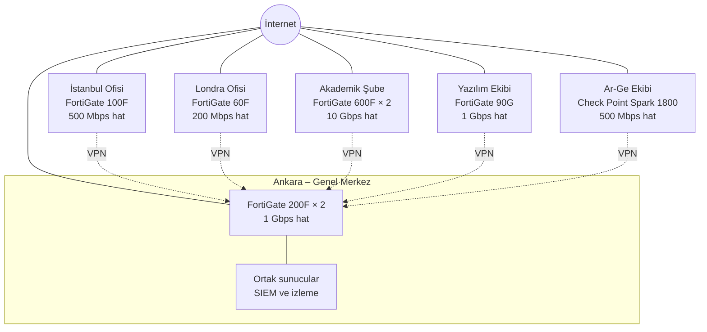

# Hayal A.Ş. — Ağ Güvenliği Planlaması

> Contributed by `Y*** Y***` ([@yusufiyilmaz](https://github.com/yusufiyilmaz)) · BGT207 Güvenlik Duvarı Çözümleri · 2026-2027 Güz midterm project.
> Student names are masked on purpose. Converted from the student's Turkish documents.

Hayali bir şirket kuruyoruz ve bu şirketin tüm şubelerine adım adım güvenlik duvarı (firewall) kuruyoruz.

**İçindekiler:** [Ağ şeması](#ağ-şeması) · [Şirket yapısı](#adım-1-şirket-yapısı) · [Bant genişliği](#adım-2-bant-genişliği) · [Güvenlik duvarları](#adım-3-her-şube-için-en-iyi-5-güvenlik-duvarı) · [Kurulum](#adım-4-adım-adım-kurulum) · [İzleme](#adım-5-i̇zleme-monitoring) · [Kurallar ve işletme](#kural-setleri-ve-işletme) · [Ankara](#ankara-ofisi-genel-merkez) · [İstanbul](#i̇stanbul-ofisi) · [Londra](#londra-ofisi) · [Akademik](#akademik-şube) · [Yazılım](#yazılım-ekibi) · [Ar-Ge](#ar-ge-ekibi) · [Kaynaklar](#kaynaklar)

## Şirket: Hayal A.Ş.

Hayal A.Ş. okullar ve şirketler için eğitim yazılımları geliştirir. Kendi akademik kampüsünü de işletir.

## Ağ şeması

Her şubenin kendi internet hattı ve kendi güvenlik duvarı var. Şubeler Ankara'daki merkeze internet üzerinden şifreli bağlantıyla (VPN, kesikli çizgiler) bağlanıyor.



## Adım 1: Şirket yapısı

**Neden önemli?** Sonraki bütün adımlar bu sayılara dayanıyor. Kaç kişi olduğunu bilmeden ne kadar internet lazım olduğunu hesaplayamayız. İnterneti bilmeden de doğru büyüklükte güvenlik duvarı seçemeyiz.

| # | Şube | Konum | Personel | Hoca | Öğrenci | Yazılımcı | Teknik (BT) | Toplam |
|---|------|-------|---------:|-----:|--------:|----------:|------------:|-------:|
| 1 | Ankara Ofisi (Genel Merkez) | Ankara | 220 | - | - | - | 20 | 240 |
| 2 | İstanbul Ofisi | İstanbul | 110 | - | - | - | 10 | 120 |
| 3 | Londra Ofisi | Londra | 35 | - | - | - | 3 | 38 |
| 4 | Akademik Şube | İstanbul | 200 | 400 | 10.000 | - | 15 | 10.615 |
| 5 | Yazılım Ekibi | İstanbul | 5 | - | - | 60 | 5 | 70 |
| 6 | Ar-Ge Ekibi | Ankara | 3 | - | - | 22 | 3 | 28 |
| | **Toplam** | | **573** | **400** | **10.000** | **82** | **56** | **11.111** |

## Sayıları nasıl belirledik?

Sayıları rastgele değil, her birini bir mantığa bağlayarak belirledik:

- **Öğrenci:** Akademik şubede 10.000 öğrenci var. Diğer sayıların çoğu buna göre hesaplandı.
- **Hoca:** Her 25 öğrenciye 1 hoca → 10.000 / 25 = 400
- **Akademik personel:** Her 50 öğrenciye 1 personel → 10.000 / 50 = 200
- **Ankara:** Genel merkez. Yönetim, insan kaynakları ve finans burada, bu yüzden en büyük ofis.
- **İstanbul:** Satış ofisi, Ankara'nın yaklaşık yarısı.
- **Londra:** Yurt dışı satış ofisi, küçük.
- **Yazılım ekibi:** İstanbul'da, çünkü yazılımcı bulmak orada daha kolay.
- **Ar-Ge ekibi:** Ankara'da ayrı bir binada. En gizli çalışmalar burada yapılıyor.
- **Teknik (BT):** Ofislerde her 10–15 çalışana 1 BT personeli. İki istisna var:
  - **Akademik şube:** 600 personel ve hocaya 15 BT personeli (40 kişiye 1). Öğrenciler kendi cihazlarını kendileri yönettiği için BT ekibi sadece kampüs ağı, laboratuvarlar ve personel bilgisayarlarıyla ilgileniyor.
  - **Ar-Ge:** 25 kişiye 3 BT personeli (8 kişiye 1). En gizli bilgiler burada ve kurallar en sıkı, bu yüzden BT desteği daha fazla.

## Adım 2: Bant genişliği

**Bant genişliği nedir?** Bir hattan aynı anda ne kadar veri geçebileceğidir. Bir yolun şerit sayısı gibi düşünülebilir: şerit ne kadar çoksa aynı anda o kadar araba geçer. Birimi **Mbps** (saniyede megabit). 1 Gbps = 1.000 Mbps.

### Nasıl hesapladık?

```
Gereken hız = Kişi sayısı × Kişi başı hız × Eşzamanlılık
İnternet hattı = Gereken hız × 1,25 → piyasada satılan bir üst hatta yuvarlanır
```

- **Kişi başı hız:** Yoğun saatte bir kişinin ortalama kullandığı internet.
- **Eşzamanlılık:** Aynı anda internette aktif olanların oranı. Herkes aynı anda video izlemez.
- **× 1,25 (yüzde 25 pay):** Ani yoğunluklar ve şirketin büyümesi için.

### Kim ne kadar kullanır?

| Kim? | Kişi başı | Eşzamanlılık | Neden? |
|------|----------:|-------------:|--------|
| Personel | 2 Mbps | %80 | E-posta, web, görüntülü toplantı. Mesai saatinde çoğu aktif |
| Teknik (BT) | 5 Mbps | %90 | Güncelleme indirme, uzaktan bağlantı, yedekleme |
| Yazılımcı | 10 Mbps | %90 | Büyük dosyalar indirir (kod, kütüphaneler, sanal sunucular) |
| Hoca | 3 Mbps | %60 | Online ders ve video |
| Öğrenci | 1 Mbps | %30 | 10.000 öğrencinin hepsi aynı anda kampüste ve internette olmaz |

### Özet

| Şube | Gereken | +%25 pay | Ana hat | Yedek hat |
|------|--------:|---------:|--------:|----------:|
| Ankara | 642 Mbps | 803 Mbps | 1 Gbps | 500 Mbps |
| İstanbul | 271 Mbps | 339 Mbps | 500 Mbps | 200 Mbps |
| Londra | 90 Mbps | 112 Mbps | 200 Mbps | 4G/5G modem |
| Akademik | 4.108 Mbps | 5.134 Mbps | 10 Gbps | 1 Gbps |
| Yazılım | 571 Mbps | 713 Mbps | 1 Gbps | 500 Mbps |
| Ar-Ge | 216 Mbps | 270 Mbps | 500 Mbps | 200 Mbps |

**Yedek hat nedir?** Farklı bir internet şirketinden alınan ikinci hat. Ana hat koparsa şube internetsiz kalmaz. Sadece arıza anında kullanıldığı için daha küçük seçildi.

### Ana hat koparsa ne olur?

Yedek hat küçük olduğu için çoğu şubede ihtiyacın tamamını karşılamıyor. Bu yüzden her şubede **önceliklendirme** yapılır: Hat yetmediğinde önemli trafik önce geçer, önemsiz olan yavaşlar veya kapanır.

| Şube | Yedek hat yeter mi? | Arıza anında ne olur? |
|------|---------------------|-----------------------|
| Ankara | Hayır (642 / 500 Mbps) | Şubelerin VPN bağlantıları ve sunucular önce geçer, toplantılar ve indirmeler yavaşlar |
| İstanbul | Hayır (271 / 200 Mbps) | Misafir Wi-Fi'ı kapanır |
| Londra | Kısmen (4G/5G) | Misafir Wi-Fi'ı kapanır. Sadece e-posta ve VPN çalışır, video engellenir |
| Akademik | Hayır (4.108 / 1.000 Mbps) | Sadece hocalar, personel ve sınav sistemi internete çıkar. Öğrenci Wi-Fi'ı durur |
| Yazılım | Hemen hemen (571 / 500 Mbps) | Büyük indirmeler biraz yavaşlar |
| Ar-Ge | Hemen hemen (216 / 200 Mbps) | Büyük yedeklemeler geceye ertelenir |

## Adım 3: Her şube için en iyi 5 güvenlik duvarı

### Neye baktık?

**1. Tehdit koruma hızı (Threat Protection Throughput)**

Üreticiler kutunun üstüne büyük bir hız yazar (örneğin "27 Gbps"). Ama bu hız, güvenlik özellikleri **kapalıyken** ölçülür. Virüs tarama, saldırı engelleme (IPS) gibi özellikler açılınca cihaz yavaşlar. Biz bu özellikler **açıkken** ölçülen hıza, yani tehdit koruma hızına baktık. Gerçek hayatta cihaz böyle çalışacak.

**2. Kural: Cihazın hızı ≥ Ana hat**

Güvenlik duvarı, internet hattından yavaş olursa kapı daralır, darboğaz olur. Bu yüzden her şubede cihazın tehdit koruma hızı, ana internet hattına eşit ya da ondan büyük olmalı.

**3. Şubenin ihtiyacı:** Öğrenci girişi, misafir Wi-Fi, merkezden yönetim, şüpheli dosya testi gibi özellikler.

**4. Yedeklilik:** Büyük şubelerde (Ankara ve Akademik) 2 cihaz birlikte çalışır. Biri bozulursa diğeri devralır. Buna **HA (High Availability)** denir. **İki cihaz hızı ikiye katlamaz:** Biri çalışır, diğeri bekler. Bu yüzden hesap tek cihazın hızına göre yapıldı. Ankara'da 2 × 3 Gbps = 6 Gbps değil, yine 3 Gbps.

Küçük şubelerde ikinci cihaz yerine Ankara'daki depoda **yedek cihaz** bekletilir: bir FortiGate ve Ar-Ge için bir Check Point. Cihaz bozulursa yedeği Türkiye'deki şubelere 1 gün içinde gönderilir. Ankara'dan Londra'ya gönderim gümrük yüzünden 2–3 gün sürer. Bu yüzden Londra için üreticinin **İngiltere'deki değişim hizmeti** kullanılır: bozuk cihazın yerine yenisi ertesi iş günü ofise getirilir.

### Seçimler

| Şube | Ana hat | Seçilen cihaz | Tehdit koruma hızı | Adet |
|------|--------:|---------------|-------------------:|-----:|
| Ankara | 1 Gbps | FortiGate 200F | 3 Gbps | 2 (HA) |
| İstanbul | 500 Mbps | FortiGate 100F | 1 Gbps | 1 |
| Londra | 200 Mbps | FortiGate 60F | 700 Mbps | 1 |
| Akademik | 10 Gbps | FortiGate 600F | 10,5 Gbps | 2 (HA) |
| Yazılım | 1 Gbps | FortiGate 90G | 2,2 Gbps | 1 |
| Ar-Ge | 500 Mbps | Check Point Quantum Spark 1800 | 2 Gbps | 1 |

Hızların kaynakları [Kaynaklar](#kaynaklar) bölümünde.

### Neden çoğunlukla FortiGate?

- **Tek yerden yönetim:** Bütün FortiGate'ler Ankara'dan tek bir ekranla yönetilir. Londra'da sadece 3 BT personeli olduğu için bu çok önemli.
- **Şubeleri birbirine bağlamak kolay:** FortiGate'ler birbirine şifreli bağlantıyla (VPN) kolayca bağlanır.
- **Fiyat:** Aynı hız için genelde rakiplerinden daha ucuz.

### Ar-Ge neden farklı (Check Point)?

Şirketin en gizli bilgileri Ar-Ge'de. Her yerde aynı marka olursa, o markada bir güvenlik açığı çıktığında saldırgan her yere aynı yoldan girebilir. Ar-Ge'de farklı bir marka kullanınca saldırgan ikinci, farklı bir duvara takılır. Ayrıca Check Point şüpheli dosyaları açmadan önce güvenli bir ortamda deneyip test edebiliyor (kum havuzu / sandbox).

## Adım 4: Adım adım kurulum

**Kurulum sırası:** Ankara → İstanbul → Londra → Yazılım → Ar-Ge → Akademik. Önce merkez kurulur, çünkü diğer şubeler ona bağlanacak. En büyük ve en riskli şube (Akademik) en sona, yarıyıl tatiline bırakılır.

**VLAN nedir?** Bir binadaki ağı, birbirini göremeyen bölümlere ayırmaktır. Bir bölümden diğerine geçmek isteyen her şey güvenlik duvarından geçer ve kurallara takılır. Biri bir bilgisayarı ele geçirse bile sadece o bölümde kalır.

Her şubeye ayrı bir adres bloğu verildi: Ankara `10.10.x.x`, İstanbul `10.20.x.x`, Londra `10.30.x.x`, Akademik `10.40.x.x` ve `10.41.x.x`, Yazılım `10.50.x.x`, Ar-Ge `10.60.x.x`.

Her şubede aynı olan 13 adım:

1. **Hazırlık:** Ağ planı, IP adresleri ve VLAN listesi hazırlanır. Kurulum saati duyurulur, geri dönüş planı yazılır.
2. **Cihaz ve kablolar:** Cihaz dolaba takılır ve UPS'e bağlanır. Ana hat, yedek hat ve şirket içi ağ kabloları takılır.
3. **Güncelleme ve isim:** Firmware en güncel sürüme yükseltilir. Cihaza isim verilir, örneğin `FG-ANKARA-01`.
4. **Önce cihazın kendisi korunur:** Fabrika şifresi değiştirilir, girişte iki adımlı doğrulama zorunlu olur, ayar ekranı sadece yönetim bölümünden (VLAN 99) açılır.
5. **Bölümler (VLAN):** VLAN'lar tanımlanır. DHCP, DNS ve NTP'ye izin verilir, unutulursa hiçbir şey çalışmaz.
6. **İnternet hatları:** Ana hat ve yedek hat tanıtılır. Hat koparsa cihaz otomatik olarak yedek hatta geçer.
7. **Güvenlik özellikleri:** IPS, antivirüs, web filtresi ve uygulama kontrolü açılır.
8. **Kurallar:** Varsayılan olarak her şey yasak, sadece gereken trafiğe tek tek izin verilir. Mantığı [Kural setleri ve işletme](#kural-setleri-ve-işletme) bölümünde.
9. **VPN:** Her şube Ankara'daki sunuculara şifreli tünelle bağlanır. Evden bağlanan personel için VPN açılır, girişte iki adımlı doğrulama zorunlu.
10. **Yedekli çalışma (HA):** Sadece Ankara ve Akademik'te. Çalışan cihaz bozulursa bekleyen birkaç saniye içinde devralır.
11. **Kayıtlar:** Cihazın kayıtları Ankara'daki izleme sistemine gönderilir.
12. **Test:** Yasaklar çalışıyor mu, kablo çekilince yedek hatta geçiliyor mu, kayıtlar Ankara'ya ulaşıyor mu denenir. Testler geçmeden kurulum bitmiş sayılmaz.
13. **Yedek ve belgeleme:** Çalışan ayarların yedeği alınır, IP planı, kablolar ve hesaplar yazılır.

## Adım 5: İzleme (monitoring)

**Neden önemli?** Güvenlik duvarı saldırıyı engeller ama bunu birinin görmesi gerekir. Kimse bakmazsa saldırgan aylarca denemeye devam edebilir.

### Sistematik kısım

Bütün güvenlik duvarlarının kayıtları Ankara'da tek bir yerde (SIEM) toplanır. Yazılım şüpheli bir şey görünce alarm verir. Bazı alarmlara otomatik müdahale edilir.

| Araç | Ne yapar? | Seçimimiz | Neden? |
|------|-----------|-----------|--------|
| **SIEM** | Bütün cihazlardan gelen kayıtları tek yerde toplar, birleştirir ve şüpheli durumda alarm verir | **Wazuh** | Ücretsiz. Her markadan kayıt alabiliyor (Ar-Ge'deki Check Point dahil) |
| **Performans izleme** | Hatların ne kadar dolu olduğunu, cihazların çalışıp çalışmadığını izler | **Zabbix** | Ücretsiz. Her marka cihazı izleyebiliyor |
| **Kayıt (ticket) sistemi** | Her alarmı bir kayda dönüştürür: kim baktı, ne yaptı, ne zaman bitti | **GLPI** | Ücretsiz. Hiçbir olay unutulmaz |

### Alarm seviyeleri

| Seviye | Örnek | Ne kadar sürede bakılır? |
|--------|-------|-------------------------:|
| 🔴 Kritik | Ar-Ge'deki sunucu izinsiz internete çıkmaya çalıştı | 15 dakika |
| 🟠 Yüksek | Aynı yerden 5 dakikada 10 yanlış şifre denendi | 1 saat |
| 🟡 Orta | İnternet hattı uzun süredir çok dolu | 4 saat |
| 🔵 Düşük | Güvenlik duvarı bilinen bir saldırıyı zaten engelledi | Ertesi gün |

**Otomatik müdahale:** Bazı alarmlarda insan beklenmez. Örneğin 10 kez yanlış şifre deneyen adres otomatik olarak 24 saat engellenir.

### İnsan kısmı

Alarmlara güvenlik ekibi (SOC) bakar. Önce L1 analist inceler, ciddiyse L2'ye iletir. Gündüz şirketin kendi ekibi, gece dışarıdan bir güvenlik firması izler.

Bizde NOC işini Ankara'daki BT ekibi yapar. SOC için ayrı bir ekip kurulur.

| Kademe | Görevi | Kişi |
|--------|--------|-----:|
| **L1 – Analist** | Alarma ilk bakan kişi. Gerçek bir olay mı, yanlış alarm mı, buna karar verir. Ciddiyse L2'ye iletir | 4 |
| **L2 – Müdahale** | Olayı derinlemesine inceler ve saldırıyı durdurur | 2 |
| **L3 – Uzman** | Alarm gelmesini beklemeden saldırı izi arar. Yeni alarm kuralları yazar | 1 |
| **SOC yöneticisi** | Ekibi yönetir, yönetime rapor verir | 1 |

## Kural setleri ve işletme

### Kurallar nasıl okunur?

Güvenlik duvarı kuralları yukarıdan aşağı okur, **eşleşen ilk kural** uygulanır. Her şubede aynı mantık izlenir:

1. **Temel servisler:** DHCP, DNS ve NTP açılır. Açılmazsa cihazlar IP alamaz, ağ durur.
2. **Yönetim:** Ayar ekranı sadece yönetim bölümünden (VLAN 99) açılır. Ankara BT'si ve Zabbix şubelerdeki cihazlara VPN üzerinden ulaşır.
3. **Yasaklar:** Misafir şirket ağına, öğrenci veritabanına, test sunucusu gerçek sistemlere giremez.
4. **İzinler:** Çalışanların kendi sunucuları, Ankara'daki ortak sunucular, internet çıkışı ve Ankara'ya VPN. Güvenlik duvarları ve sunucular güncellemelerini de bu izinlerle indirir. Son kural her şeyi kapattığı için bu izinler tek tek yazılır.
5. **Son kural (default deny):** Yukarıda izin verilmeyen her şey engellenir ve kaydedilir.

**Kurallardaki portlar ne?** 80 ve 443 web, 445 dosya paylaşımı, 514 güvenlik duvarı kayıtları, 587 ve 993 e-posta, 22 yönetim ve test sunucularına bağlantı, 161 Zabbix'in cihaz sağlığını okuması, 500 ve 4500 VPN.

**Akademik şubede sıra neden değişti?** Torrent yasağı, öğrenci hız sınırının altındaydı. İlk eşleşen kural uygulandığı için torrent hız sınırı kuralına takılıp geçiyordu. Yasağı üste aldık.

**Ar-Ge'de ne değişti?** İnternetten kum havuzuna izin veren kural yanlıştı, çünkü dışarıdan içeri kapı açıyordu. Yerine araştırmacıların sadece işle ilgili sitelere çıktığı kural geldi. İndirilen dosyalar yine kum havuzunda denenir.

### Web siteleri ve uygulamalar

| Ne? | Nerede? | Nasıl korunuyor? |
|-----|---------|------------------|
| Şirket web sitesi | Ankara DMZ (VLAN 40) | Önünde Cloudflare WAF var. DMZ'ye sadece Cloudflare adresleri ulaşır |
| Not ve uzaktan eğitim sistemi | Akademik sunucu bölümü (VLAN 60) | İnternete açık değil. Kampüsten web ile, personel dışarıdan VPN ile girer |
| Mobil uygulama ve açık API | Yok | |

**WAF nedir?** Güvenlik duvarı kapıdaki adresi ve portu kontrol eder. WAF ise web sitesine gelen isteğin içine bakar, SQL injection gibi saldırıları durdurur. Cloudflare ayrıca DDoS saldırılarını da karşılar.

### Yedekli çalışma

Ankara ve Akademik şubede iki cihaz vardır (HA, aktif-pasif). Biri bozulursa diğeri birkaç saniyede devralır.

### Kayıt saklama

| Kayıt türü | Süre | Neden? |
|------------|------|--------|
| Akademik şube ve İstanbul misafir Wi-Fi'ı internet erişim kayıtları | En az 2 yıl, zaman damgalı | 5651 sayılı kanun |
| Güvenlik duvarı ve güvenlik olayları | 1 yıl (son 90 gün hızlı erişilebilir) | Olay araştırması ve denetim |
| Londra kayıtları | Gerektiği kadar, en az kişisel veriyle | UK GDPR |
| Kamera kayıtları ve kişisel veriler | Gerektiği kadar | KVKK |

### Yedek ve güncelleme

Bu işlerin sorumlusu Ankara BT ekibidir.

- **Ayar yedeği:** Her gece ve her değişiklikten sonra cihaz ayarları Ankara'daki yedek sunucuya alınır. 3 ayda bir yedekten geri yükleme denenir.
- **Güncelleme:** Fortinet ve Check Point duyuruları otomatik takip edilir, güvenlik güncellemesi çıkar çıkmaz yüklenir. Ayrıca 30 günde bir bütün cihazların firmware'i kontrol edilir.

### Takip edilen açıklar (CVE)

| CVE | Etkilenen | Geçici önlem | Kalıcı çözüm |
|-----|-----------|--------------|--------------|
| CVE-2026-24858 | FortiGate şubeleri | FortiCloud ile yönetici girişi kapalı, ayar ekranı sadece VLAN 99'dan açılır | FortiOS düzeltilmiş sürüme yükseltilir (7.6.6, 7.4.11, 7.2.13, 7.0.19 veya üstü) |
| CVE-2024-24919 | Ar-Ge Check Point | Remote Access VPN ve Mobile Access kapalı, çünkü açık ancak bunlardan biri çalışırken kullanılabiliyor | Quantum Spark için Check Point yaması yüklenir |

### Fiyatlar

Fiyatlar yaklaşık ve dolar cinsinden. Üreticiler her modelin fiyatını yayınlamadığı için satıcı sayfalarından alındı. Lisans, destek ve kura göre değişir, gerçek fiyat için teklif alınır.

| Marka | Yaklaşık fiyat ($) | Neye göre? |
|-------|--------------------|------------|
| FortiGate | 60F 765, 70F 955, 90G 2.150, 100F 3.240, 200F 5.544, 600F 22.108 | Satıcı liste fiyatı |
| Palo Alto | PA-440 1.804, PA-460 4.500, PA-1420 20.778, PA-3440 29.776 | Satıcı fiyatı. PA-460 üçüncü taraf tahmini, PA-3440 pazaryeri fiyatı |
| Check Point | Spark 1600 5.049, Spark 1800 6.731, Force 9100 56.030, Force 19100 116.229 | 1 yıllık paket. Force 9100 Plus model |
| Cisco | 3105 31.155, 3120 59.978 | Satıcı fiyatı |
| Sophos | XGS 2100 2.293, XGS 2300 3.495, XGS 5500 23.586 | Satıcı fiyatı |
| Diğer | pfSense (Netgate 6100) 949, OPNsense 0 | Netgate üretici mağazası, MAX model. OPNsense ücretsiz, sunucu parası ayrı |

Check Point fiyatları abonelik içerdiği için sadece cihaz fiyatlarıyla birebir karşılaştırılmaz. Ankara ve Akademik'te iki cihaz olduğu için cihaz maliyeti iki katıdır.

# Ankara Ofisi (Genel Merkez)

Şirketin yönetim merkezi. Yönetim, insan kaynakları ve finans burada.

## Bant genişliği

| Kim? | Kişi | Kişi başı | Eşzamanlılık | Gereken |
|------|-----:|----------:|-------------:|--------:|
| Personel | 220 | 2 Mbps | %80 | 352 Mbps |
| Teknik (BT) | 20 | 5 Mbps | %90 | 90 Mbps |
| Sunucu ve VPN trafiği | - | - | - | 200 Mbps |
| **Toplam** | | | | **642 Mbps** |

**Sunucu ve VPN trafiği neden var?** Şirketin ortak sunucuları (e-posta, dosya sunucusu) genel merkezde. Diğer şubeler bu sunuculara internet üzerinden şifreli bir bağlantıyla (VPN) bağlanıyor. Bu trafik de Ankara'nın hattından geçtiği için ayrıca ekledik.

## En uygun 5 güvenlik duvarı

**İhtiyaç:** 803 Mbps (ana hat 1 Gbps). Diğer 5 şubenin VPN bağlantıları burada sonlanıyor. Ortak sunucular burada.  
**Kural:** Tehdit koruma hızı ≥ 1 Gbps. Cihazlar 2 adet, yedekli (HA) çalışacak.

| # | Cihaz | Tehdit koruma hızı | Neden bu sırada? |
|---|-------|-------------------:|------------------|
| 1 | **FortiGate 200F** | 3 Gbps | Diğer şubelerdeki FortiGate'lerle aynı ekrandan yönetilir. Bütün şubelerin bağlandığı merkez olmaya uygun. 1 Gbps hattın 3 katı hız, büyüme payı var |
| 2 | Palo Alto PA-1420 | 4,8 Gbps | Hangi uygulamanın kullanıldığını çok iyi tanır. Daha pahalı |
| 3 | Check Point Quantum Force 9100 | 4,95 Gbps | Kurumsal yönetim paneli çok gelişmiş. Lisans maliyeti yüksek |
| 4 | Cisco Secure Firewall 3105 | 10 Gbps | Çok güçlü, ağda Cisco switch varsa uyumlu. Bu şube için fazla büyük ve pahalı |
| 5 | Sophos XGS 2300 | 1,4 Gbps | Uygun fiyatlı, kullanımı kolay. 1 Gbps hatta yetiyor ama büyüme payı az |

## Seçim: FortiGate 200F (2 adet, HA)

- Genel merkez durursa tüm şirket durur. Bu yüzden 2 cihaz kullanılıyor, biri bozulursa diğeri saniyeler içinde devralır.
- Diğer şubelere de FortiGate konacağı için hepsi buradan, tek panelden yönetilebilir.

## Bölümler (VLAN)

| VLAN | Bölüm | Adres | Kimler? |
|-----:|-------|-------|---------|
| 10 | BT | 10.10.10.0/24 | 20 BT personeli |
| 20 | Çalışan | 10.10.20.0/24 | 220 personel |
| 30 | Sunucu | 10.10.30.0/24 | E-posta, dosya sunucusu, izleme sistemleri |
| 40 | DMZ | 10.10.40.0/24 | İnternete açık sunucular (şirket web sitesi) |
| 80 | IoT | 10.10.80.0/24 | Kamera, yazıcı, kartlı giriş |
| 99 | Yönetim | 10.10.99.0/24 | Cihazların ayar ekranları |

**DMZ nedir?** İnternetten herkesin erişebildiği sunucuların konduğu ayrı bölge. Web sitesi hacklenirse saldırgan DMZ'de kalır, şirketin iç ağına geçemez.

# İstanbul Ofisi

Satış ve operasyon ofisi. Müşterilerle burada çalışılır.

## Bant genişliği

| Kim? | Kişi | Kişi başı | Eşzamanlılık | Gereken |
|------|-----:|----------:|-------------:|--------:|
| Personel | 110 | 2 Mbps | %80 | 176 Mbps |
| Teknik (BT) | 10 | 5 Mbps | %90 | 45 Mbps |
| Misafir Wi-Fi | - | - | - | 50 Mbps |
| **Toplam** | | | | **271 Mbps** |

**Misafir Wi-Fi neden var?** Satış ofisine müşteriler geliyor. Misafir Wi-Fi'ı toplam 50 Mbps ile sınırlıyoruz, böylece misafirler çalışanların internetini yavaşlatamaz.

## En uygun 5 güvenlik duvarı

**İhtiyaç:** 339 Mbps (ana hat 500 Mbps). Misafir Wi-Fi'ı var. Ankara'ya VPN ile bağlanacak.  
**Kural:** Tehdit koruma hızı ≥ 500 Mbps.

| # | Cihaz | Tehdit koruma hızı | Neden bu sırada? |
|---|-------|-------------------:|------------------|
| 1 | **FortiGate 100F** | 1 Gbps | Ankara'daki FortiGate ile aynı panelden yönetilir. Misafir Wi-Fi'ı ayrı ağa almak kolay |
| 2 | Sophos XGS 2100 | 1,25 Gbps | Uygun fiyatlı, arayüzü kolay. Ama Ankara'dan ayrı bir panelle yönetilmesi gerekir |
| 3 | Check Point Quantum Spark 1600 | 1,5 Gbps | Küçük ofisler için iyi. Lisans maliyeti yüksek |
| 4 | Palo Alto PA-440 | ~1 Gbps | Güvenlik çok iyi. Ama Ankara'dan ayrı bir panelle yönetilmesi gerekir ve lisansları ayrı alınır |
| 5 | pfSense (Netgate 6100) | ~1 Gbps (IPS açıkken, kurallara göre değişir) | Ücretsiz yazılım, ucuz donanım. Ama üretici desteği sınırlı ve BT ekibinin bilgisi önemli |

## Seçim: FortiGate 100F (1 adet)

- Hattın 2 katı hızda, yani darboğaz olmaz.
- Cihaz bozulursa yedeği Ankara'dan 1 gün içinde gönderilebilir. Bu yüzden ikinci cihaz alınmadı.

## Bölümler (VLAN)

| VLAN | Bölüm | Adres | Kimler? |
|-----:|-------|-------|---------|
| 10 | BT | 10.20.10.0/24 | 10 BT personeli |
| 20 | Çalışan | 10.20.20.0/24 | 110 personel |
| 50 | Misafir | 10.20.50.0/24 | Misafir ve müşteri Wi-Fi'ı |
| 80 | IoT | 10.20.80.0/24 | Kamera, yazıcı, kartlı giriş |
| 99 | Yönetim | 10.20.99.0/24 | Cihazın ayar ekranı |

# Londra Ofisi

Yurt dışı satış ofisi. Küçük bir ekip.

## Bant genişliği

| Kim? | Kişi | Kişi başı | Eşzamanlılık | Gereken |
|------|-----:|----------:|-------------:|--------:|
| Personel | 35 | 2 Mbps | %80 | 56 Mbps |
| Teknik (BT) | 3 | 5 Mbps | %90 | 13,5 Mbps |
| Misafir Wi-Fi | - | - | - | 20 Mbps |
| **Toplam** | | | | **~90 Mbps** |

**Neden 100 değil de 200 Mbps?** 112 Mbps, 100 Mbps'lik hatta sığmaz. Fiyat farkı da az.

**Misafir Wi-Fi'ı neden sınırlı?** Misafir Wi-Fi'ını toplam 20 Mbps ile sınırlıyoruz, böylece misafirler çalışanların internetini yavaşlatamaz.

**Yedek hat neden 4G/5G modem?** Ofis küçük. Arıza anında e-posta ve VPN çalışsın yeter. İkinci bir fiber hat bu ofis için pahalı olur.

## En uygun 5 güvenlik duvarı

**İhtiyaç:** 112 Mbps (ana hat 200 Mbps). BT ekibi sadece 3 kişi. Ankara'dan uzaktan yönetilmeli.  
**Kural:** Tehdit koruma hızı ≥ 200 Mbps.

| # | Cihaz | Tehdit koruma hızı | Neden bu sırada? |
|---|-------|-------------------:|------------------|
| 1 | **FortiGate 60F** | 700 Mbps | Ankara'dan uzaktan yönetilir. Küçük ve ucuz. Ana hat koparsa 4G/5G yedek hatta otomatik geçer |
| 2 | Check Point Quantum Spark 1600 | 1,5 Gbps | Küçük ofislerde yaygın. Ama ayrı panel ve pahalı lisans |
| 3 | Palo Alto PA-440 | ~1 Gbps | Çok güvenli ama 38 kişilik ofis için pahalı |
| 4 | Sophos XGS 2100 | 1,25 Gbps | Bu ofis için fazla büyük. Sophos'un daha küçük modelleri de kullanılabilir |
| 5 | pfSense (Netgate 6100) | ~1 Gbps (IPS açıkken, kurallara göre değişir) | Ucuz. Ama uzaktan yönetimi ve desteği diğerleri kadar kolay değil |

## Seçim: FortiGate 60F (1 adet)

- Ankara'daki BT ekibi Londra'yı kendi ekranından yönetebilir, oraya gitmesine gerek kalmaz.
- Cihaz bozulursa Ankara'dan göndermek gümrük yüzünden 2–3 gün sürer. Bu yüzden üreticinin İngiltere'deki değişim hizmeti kullanılır, yeni cihaz ertesi iş günü gelir.
- Avrupa'daki müşteri verileri Türkiye'ye şifreli VPN ile taşınır. Bu UK GDPR açısından da önemli.

## Bölümler (VLAN)

| VLAN | Bölüm | Adres | Kimler? |
|-----:|-------|-------|---------|
| 10 | BT | 10.30.10.0/24 | 3 BT personeli |
| 20 | Çalışan | 10.30.20.0/24 | 35 personel |
| 50 | Misafir | 10.30.50.0/24 | Misafir Wi-Fi'ı |
| 80 | IoT | 10.30.80.0/24 | Kamera, yazıcı, kartlı giriş |
| 99 | Yönetim | 10.30.99.0/24 | Cihazın ayar ekranı |

# Akademik Şube

Şirketin kampüsü. Öğrenciler, hocalar ve personel burada. En kalabalık şube.

## Bant genişliği

| Kim? | Kişi | Kişi başı | Eşzamanlılık | Gereken |
|------|-----:|----------:|-------------:|--------:|
| Öğrenci | 10.000 | 1 Mbps | %30 | 3.000 Mbps |
| Hoca | 400 | 3 Mbps | %60 | 720 Mbps |
| Personel | 200 | 2 Mbps | %80 | 320 Mbps |
| Teknik (BT) | 15 | 5 Mbps | %90 | 67,5 Mbps |
| **Toplam** | | | | **~4.108 Mbps** |

**Neden 10 Gbps?** 5 Gbps gerekiyor. Hatlar genelde 1 Gbps ve 10 Gbps olarak satılır, arası yok.

## En uygun 5 güvenlik duvarı

**İhtiyaç:** 5,1 Gbps (ana hat 10 Gbps). 10.000'den fazla kullanıcı, öğrencilerin kendi cihazları, 5651 sayılı kanuna göre kayıt tutma (Türkiye'de toplu internet veren yerler kimin ne zaman bağlandığını kaydetmek zorunda), öğrencilerin internete kimlikleriyle giriş yapması (captive portal).  
**Kural:** Tehdit koruma hızı ≥ 10 Gbps. Cihazlar 2 adet, yedekli (HA) çalışacak.

| # | Cihaz | Tehdit koruma hızı | Neden bu sırada? |
|---|-------|-------------------:|------------------|
| 1 | **FortiGate 600F** | 10,5 Gbps | 10 Gbps hattı karşılıyor. Captive portal, kullanıcı başı hız sınırı ve kayıt tutma hazır geliyor. Diğer şubelerle aynı panel |
| 2 | Palo Alto PA-3440 | 12,8 Gbps | Daha hızlı ve uygulama tanıması çok iyi. Ama 2 cihaz alındığında maliyet çok artıyor |
| 3 | Sophos XGS 5500 | 12,4 Gbps | Hızlı ve görece ucuz. Eğitim kurumlarında yaygın |
| 4 | Cisco Secure Firewall 3120 | 21 Gbps | Çok güçlü, büyüme payı fazla. Yönetimi daha karmaşık ve pahalı |
| 5 | Check Point Quantum Force 19100 | 28,8 Gbps | En güçlü aday ama bu şube için fazla büyük ve en pahalısı |

## Seçim: FortiGate 600F (2 adet, HA)

- Şirketin en kalabalık şubesi. Güvenlik duvarı bozulursa 10.000 kişi internetsiz kalır, bu yüzden 2 cihaz kullanılıyor.
- Öğrenciler internete okul numarası ve şifreyle giriyor (captive portal). Böylece 5651 sayılı kanunun istediği "hangi kullanıcı, ne zaman, hangi IP" kaydı tutulabiliyor.

**Ücretsiz pfSense/OPNsense neden listede yok?** 10 Gbps hızda IPS çalıştırmak için çok güçlü bir sunucu gerekir. 10.000 kişilik bir şubede sorun çıktığında üreticiden 7/24 destek almak da önemli.

## Bölümler (VLAN)

| VLAN | Bölüm | Adres | Kimler? |
|-----:|-------|-------|---------|
| 10 | BT | 10.40.10.0/24 | 15 BT personeli |
| 20 | Personel | 10.40.20.0/24 | 200 personel |
| 30 | Hoca | 10.40.30.0/23 | 400 hoca |
| 50 | Laboratuvar | 10.40.50.0/24 | Bilgisayar laboratuvarları |
| 60 | Sunucu | 10.40.60.0/24 | Not sistemi, uzaktan eğitim sistemi |
| 70 | Öğrenci Wi-Fi | 10.41.0.0/16 | 10.000 öğrenci |
| 80 | IoT | 10.40.80.0/24 | Kamera, turnike, yazıcı |
| 99 | Yönetim | 10.40.99.0/24 | Cihazların ayar ekranları |

**Öğrenci bölümü neden bu kadar büyük?** Her öğrencinin telefon, laptop gibi 2–3 cihazı var. 10.000 öğrenci için 20.000–30.000 adres lazım. `/16` yaklaşık 65.000 adres verir.

## Akademik şubeye özel adımlar

1. **Neden yarıyıl tatilinde?** Dersler ve sınavlar aksamasın. Kampüs boşken sorunlar sakince çözülür.
2. **Öğrenci girişi:** Öğrenci Wi-Fi'a bağlanınca bir giriş sayfası açılır, öğrenci numarası ve şifresiyle girer. Böylece her bağlantının kime ait olduğu bilinir.
3. **5651 sayılı kanun:** "Hangi öğrenci, ne zaman, hangi adresi aldı" kayıtları en az 2 yıl saklanır.
4. **Hız sınırı:** Her öğrenci en fazla 5 Mbps kullanabilir.
5. **Öğrenciler not sistemine giremez:** Öğrenci bölümü, sunuculara sadece web sitesi üzerinden erişebilir. Veritabanına erişemez.
6. **Öğrenciler birbirini göremez:** Wi-Fi'da her öğrencinin cihazı diğerlerinden yalıtılır.

# Yazılım Ekibi

Şirketin eğitim yazılımlarını geliştiren ekip. İstanbul'da.

## Bant genişliği

| Kim? | Kişi | Kişi başı | Eşzamanlılık | Gereken |
|------|-----:|----------:|-------------:|--------:|
| Yazılımcı | 60 | 10 Mbps | %90 | 540 Mbps |
| Personel | 5 | 2 Mbps | %80 | 8 Mbps |
| Teknik (BT) | 5 | 5 Mbps | %90 | 22,5 Mbps |
| **Toplam** | | | | **~571 Mbps** |

**Neden yazılımcı başı 10 Mbps?** Yazılımcılar gün içinde büyük dosyalar indirir ve gönderir: kod depoları, kütüphaneler, bulut sunuculara yüklemeler.

## En uygun 5 güvenlik duvarı

**İhtiyaç:** 713 Mbps (ana hat 1 Gbps). GitHub, paket depoları ve bulut sunuculara sorunsuz erişim. Kaynak kod dışarı sızmamalı.  
**Kural:** Tehdit koruma hızı ≥ 1 Gbps.

| # | Cihaz | Tehdit koruma hızı | Neden bu sırada? |
|---|-------|-------------------:|------------------|
| 1 | **FortiGate 90G** | 2,2 Gbps | Hattın 2 katı hız. Diğer şubelerle aynı panel. Kaynak kodun dışarı gönderilmesini engelleyebiliyor (DLP) |
| 2 | Palo Alto PA-460 | 2,1 Gbps | Uygulama tanıması çok iyi. Örneğin GitHub'da "okumaya izin ver, başka hesaba yüklemeyi engelle" denebilir. Pahalı |
| 3 | Check Point Quantum Spark 1800 | 2 Gbps | Güvenli, hızı yeterli. Ayrı panel ve pahalı lisans |
| 4 | Sophos XGS 2300 | 1,4 Gbps | Uygun fiyatlı ama 1 Gbps hatta büyüme payı az |
| 5 | OPNsense (kendi sunucumuzda) | ~1 Gbps (IPS açıkken, donanıma göre değişir) | Ücretsiz. DevOps ekibi yönetebilir. Ama üretici desteği yok ve hız sınırda |

## Seçim: FortiGate 90G (1 adet)

- Yazılımcılar büyük dosyalar indiriyor. Güvenlik duvarı yavaş olursa iş durur, bu yüzden hattın 2 katı hızda bir cihaz seçildi.
- 2. sıradaki Palo Alto uygulama kontrolünde daha iyi. Bütçe yeterliyse o da tercih edilebilir.

## Bölümler (VLAN)

| VLAN | Bölüm | Adres | Kimler? |
|-----:|-------|-------|---------|
| 10 | BT | 10.50.10.0/24 | 5 BT personeli |
| 20 | Yazılımcı | 10.50.20.0/24 | 60 yazılımcı + 5 personel |
| 30 | Test sunucuları | 10.50.30.0/24 | Yazılımların denendiği sunucular |
| 80 | IoT | 10.50.80.0/24 | Kamera, yazıcı, kartlı giriş |
| 99 | Yönetim | 10.50.99.0/24 | Cihazın ayar ekranı |

# Ar-Ge Ekibi

Yeni ürünler üzerinde çalışan ekip. Ankara'da, diğer birimlerden ayrı bir binada. Şirketin en gizli çalışmaları burada.

**Neden ayrı binada?** Şirketin en değerli bilgileri (yeni ürün fikirleri, kaynak kod) burada. Başka bir şubeye saldırı olsa bile Ar-Ge'ye ulaşmak zor olsun diye ayrı tutuldu.

## Bant genişliği

| Kim? | Kişi | Kişi başı | Eşzamanlılık | Gereken |
|------|-----:|----------:|-------------:|--------:|
| Mühendis / Yazılımcı | 22 | 10 Mbps | %90 | 198 Mbps |
| Personel | 3 | 2 Mbps | %80 | 4,8 Mbps |
| Teknik (BT) | 3 | 5 Mbps | %90 | 13,5 Mbps |
| **Toplam** | | | | **~216 Mbps** |

**Neden 300 değil de 500 Mbps?** Ar-Ge'nin büyük deney ve tasarım dosyaları Ankara'daki sunuculara yedekleniyor. Bu yedeklemeler hattı zaman zaman dolduruyor.

## En uygun 5 güvenlik duvarı

**İhtiyaç:** 270 Mbps (ana hat 500 Mbps). Şirketin en gizli verileri burada. Hızdan çok güvenlik önemli.  
**Kural:** Tehdit koruma hızı ≥ 500 Mbps. Kum havuzu (sandbox) ve veri sızıntısı koruması (DLP) olmalı.

| # | Cihaz | Tehdit koruma hızı | Neden bu sırada? |
|---|-------|-------------------:|------------------|
| 1 | **Check Point Quantum Spark 1800** | 2 Gbps | Diğer şubelerden farklı üretici. SandBlast kum havuzu şüpheli dosyaları açılmadan önce test ediyor |
| 2 | Palo Alto PA-440 | ~1 Gbps | WildFire kum havuzu çok iyi. O da farklı bir üretici olur |
| 3 | FortiGate 70F | 800 Mbps | Hızı yeterli ama diğer şubelerle aynı üretici olduğu için katmanlı güvenlik zayıflar |
| 4 | Sophos XGS 2100 | 1,25 Gbps | İyi ama kum havuzu ve DLP özellikleri ilk ikisi kadar güçlü değil |
| 5 | pfSense (Netgate 6100) | ~1 Gbps (IPS açıkken, kurallara göre değişir) | Ucuz ama kum havuzu ve DLP hazır gelmiyor. En gizli şube için uygun değil |

## Seçim: Check Point Quantum Spark 1800 (1 adet)

- **Katmanlı güvenlik (defense in depth):** Şirketin geri kalanında FortiGate var. FortiGate'te bir güvenlik açığı çıkarsa saldırgan Ar-Ge'ye aynı yoldan giremez, ikinci bir duvara takılır.
- **Yedek cihaz:** Ankara'daki depoda Ar-Ge için ayrıca bir Check Point bekletilir. Diğer şubelerin yedeği FortiGate olduğu için Ar-Ge'ye uymaz.
- Hız, gerekenin çok üstünde. Çünkü burada her trafik en sıkı şekilde (SSL denetimi, kum havuzu) kontrol edilecek ve bu da cihazı yavaşlatır.

## Bölümler (VLAN)

| VLAN | Bölüm | Adres | Kimler? |
|-----:|-------|-------|---------|
| 10 | BT | 10.60.10.0/24 | 3 BT personeli |
| 20 | Araştırmacı | 10.60.20.0/24 | 22 mühendis + 3 personel |
| 30 | Ar-Ge sunucuları | 10.60.30.0/24 | Proje dosyaları, deney verileri |
| 80 | IoT | 10.60.80.0/24 | Kamera, yazıcı, kartlı giriş |
| 99 | Yönetim | 10.60.99.0/24 | Cihazın ayar ekranı |

## Ar-Ge'ye özel adımlar

1. **Ayrı yönetim:** Farklı marka olduğu için diğer şubelerle aynı ekrandan yönetilmez. Sadece yetkili 2 kişi erişebilir.
2. **İki farklı marka arasında VPN:** Ankara'daki FortiGate ile bu cihazın şifreleme ayarları birebir aynı olmalı, yoksa bağlantı kurulmaz. Bu yüzden ayrıca test edilir.
3. **En sıkı kurallar:** İnternette sadece işle ilgili sitelere izin verilir, gerisi kapalı.
4. **Şüpheli dosya testi (kum havuzu):** İnternetten gelen her dosya, kullanıcıya ulaşmadan önce güvenli bir ortamda açılıp denenir. Zararlıysa engellenir.
5. **Dosya sızıntısına karşı:** Google Drive, Dropbox ve kişisel e-postaya dosya göndermek kapalı.

# Kaynaklar

Hız değerleri üreticilerin teknik belgelerinden (datasheet) ve satıcı sayfalarından alındı (Ekim 2026).

| Üretici | Kaynak |
|---------|--------|
| Fortinet (FortiGate) | [Fortinet Product Matrix (2024)](https://www.boll-europe.at/datasheets/Fortinet_Product_Matrix.pdf), [Nomios – FortiGate modelleri](https://www.nomios.com/partners/fortinet/network-security/fortigate-firewall/entry-and-mid-range/), [SHI – FortiGate 600F](https://www.shi.com/product/44900362/Fortinet-FortiGate-600F), [datacenter360 – FortiGate 90G](https://datacenter360.ca/fortinet/fortigate/fortigate-90g-firewall/) |
| Palo Alto Networks | [Palo Alto – donanım güvenlik duvarı serileri](https://www.paloaltonetworks.com/resources/infographics/hwfw-upgrade) |
| Check Point | [Quantum Spark 1900/2000 datasheet](https://www.checkpoint.com/downloads/quantum-spark-1900-2000-datasheet.pdf), [Check Point cihaz karşılaştırması](https://www.checkpoint.com/check-point-security-appliances-comparison), [Quantum Force 9100](https://www.checkpoint.com/quantum/force/9100/), [Quantum Force 19100](https://www.checkpoint.com/quantum/force/19100/) |
| Cisco | [Secure Firewall 3100 datasheet](https://www.cisco.com/c/en/us/products/collateral/security/firewalls/secure-firewall-3100-series-ds.html) |
| Sophos | [Sophos XGS serisi](https://www.sophos.com/en-gb/products/next-gen-firewall/xgs-1u-distributed-edge-firewalls) |
| Netgate (pfSense) | [Netgate 6100](https://shop.netgate.com/products/6100-base-pfsense), [Suricata forumu – IPS açıkken hız düşüşü](https://forum.suricata.io/t/throughput-drop-on-netgate-8200-max-lan-vlan-ix1-with-suricata-inline-mode/6060) |
