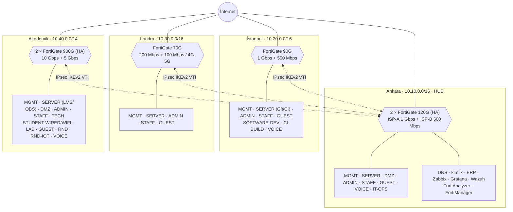

# K1-FW — Çok Lokasyonlu Kurumsal Ağ ve Güvenlik Duvarı

> Contributed by `H*** A*** K***` ([@frudotz](https://github.com/frudotz)) · BGT207 Güvenlik Duvarı Çözümleri · 2026-2027 Güz midterm project.
> Student names are masked on purpose.
>
> **Kaynak:** [frudotz/k1-fw](https://github.com/frudotz/k1-fw) · commit [`8944a81`](https://github.com/frudotz/k1-fw/tree/8944a81eea830fc9aac2afa8fdc7c5d7a53a8632) (2026-11-06 revizyonu). Bu klasör, o depodaki tasarımın firewall-lab yapısına aktarılmış hâlidir. Tasarım kararları değiştirilmedi.
> **Durum:** Tasarım ve dokümantasyon tamamlandı. Laboratuvar (GNS3 + pfSense CE 2.9) **henüz kurulmadı**. Hiçbir cihaz yapılandırılmadı ve hiçbir test çalıştırılmadı.

**Sayıların niteliği.** Kurgusal kurumun gerçek trafik ölçümü yoktur. Ödev metninden gelen tek olgu **10.000 öğrencidir**. Diğer bütün personel, Mbps ve hat değerleri **tasarım varsayımıdır**. Firewall kapasiteleri ise **üreticilerin resmi datasheet değerleridir** (erişim: 2026-11-06). Varsayımların tam listesi kaynak depoda: [`requirements/assumptions-and-open-questions.md`](https://github.com/frudotz/k1-fw/blob/8944a81eea830fc9aac2afa8fdc7c5d7a53a8632/requirements/assumptions-and-open-questions.md).

---

## 1. Kurum ve lokasyonlar

K1-FW; Türkiye'de iki ofisi, Londra'da bir temsilciliği ve 10.000 öğrencili bir akademik kampüsü olan kurgusal bir eğitim ve yazılım kurumudur.

| Lokasyon | Rolü | Kullanım türü |
|---|---|---|
| **Ankara Ofisi** | Genel merkez, **VPN hub**, merkezi sunucular, BT ve Ağ Operasyonları | ERP, İK, finans; merkezi DNS, kimlik, log ve izleme sistemleri |
| **İstanbul Ofisi** | Ofis + Yazılım Mühendisliği ekibi | Git, CI/CD, paket indirme, container imajları (ani ve yoğun trafik) |
| **Londra Ofisi** | Küçük satış/temsilcilik ofisi | Web, e-posta, saat farkı nedeniyle yoğun video konferans. Yerinde BT personeli yok |
| **Akademik Kampüs** | Eğitim kampüsü + Ar-Ge ekibi | LMS, öğrenci bilgi sistemi (ÖBS), kampüs Wi-Fi, laboratuvarlar, Ar-Ge veri aktarımı |

Temel kararlar:

- Her lokasyonun **yerel internet çıkışı** ve farklı operatörden **ana + yedek** hattı vardır. Kullanıcı trafiği Ankara'ya taşınmaz.
- Her lokasyonda **default deny** çalışan bir firewall vardır.
- Lokasyonlar Ankara merkezli **IPsec IKEv2 hub-and-spoke** tünelleriyle bağlanır.
- Kullanıcı grupları VLAN'lere ayrılır. VLAN'ler arası trafik yalnızca firewall kurallarıyla açılır.
- Bütün cihazlar Ankara'daki merkezi izleme ve log sistemine bağlıdır. Her lokasyonda bir yerel toplayıcı veri tamponlar.

## 2. Personel dağılımı

| Lokasyon | Birim / rol | Kişi |
|---|---|---:|
| Ankara | İdari personel (İK, finans, yönetim) | 50 |
| Ankara | Ofis personeli (satış, pazarlama, destek) | 100 |
| Ankara | BT: BT müdürü 1, ağ mühendisi 3, sistem yöneticisi 5, yardım masası 4 | 13 |
| Ankara | BT: güvenlik uzmanı | 2 |
| İstanbul | İdari/ofis personeli | 100 |
| İstanbul | Yazılım: geliştirici 45, DevOps 5, QA/test 8, ürün/analist 2 | 60 |
| İstanbul | Yerel teknik personel | 2 |
| Londra | Satış/temsilcilik personeli | 30 |
| Akademik | Öğrenci | **10.000 (olgu)** |
| Akademik | Akademisyen / öğretim elemanı | 600 |
| Akademik | İdari personel (öğrenci işleri, mali işler) | 300 |
| Akademik | Teknik personel (lab, AV, saha desteği) | 100 |
| Akademik | Ar-Ge: araştırmacı 25, mühendis 10, teknisyen 3, yönetici 2 | 40 |

| Lokasyon | İdari | Akademisyen | Öğrenci | Yazılım | Teknik | Güvenlik | Ar-Ge | **Toplam** |
|---|---:|---:|---:|---:|---:|---:|---:|---:|
| Ankara | 150 | 0 | 0 | 0 | 13 | 2 | 0 | **165** |
| İstanbul | 100 | 0 | 0 | 60 | 2 | 0 | 0 | **162** |
| Londra | 30 | 0 | 0 | 0 | 0 | 0 | 0 | **30** |
| Akademik | 300 | 600 | 10.000 | 0 | 100 | 0 | 40 | **11.040** |
| **Toplam** | **580** | **600** | **10.000** | **60** | **115** | **2** | **40** | **11.397** |

Misafirler (Ankara ~20, İstanbul ~15, Londra ~10, Akademik etkinliklerde 500–2.000) personel olmadığı için toplama girmez. Yalnızca GUEST VLAN'ında ve sınırlı bir bant havuzunda yer alırlar.

**`company.json` eşlemesi.** Şemanın `population` alanında yalnızca `staff`, `students`, `rnd` ve `software` vardır. İdari, akademisyen, teknik ve güvenlik personeli `staff` altında toplandı: Ankara 165, İstanbul 102 (+ `software` 60), Londra 30, Akademik 1.000 (+ `students` 10.000, `rnd` 40). Toplam yine 11.397'dir.

## 3. Genel bant genişliği matrisi

| Lokasyon | Toplam kişi | Tepe trafik ↓ / ↑ (tahmin) | Gerekli hat | **Ana hat** | **Yedek hat** | **Üretim firewall** |
|---|---:|---:|---:|---|---|---|
| Ankara | 165 | 446 / 337 Mbps | 743 Mbps | 1 Gbps | 500 Mbps | 2 × FortiGate 120G (HA) |
| İstanbul | 162 | 391 / 219 Mbps | 651 Mbps | 1 Gbps | 500 Mbps | FortiGate 90G |
| Londra | 30 | 68 / 48 Mbps | 114 Mbps | 200 Mbps | 100 Mbps veya 4G/5G | FortiGate 70G |
| Akademik | 11.040 | 4,85 / 1,68 Gbps | 8,09 Gbps | 10 Gbps | 5 Gbps | 2 × FortiGate 900G (HA) |

- **Bu değerlerin hiçbiri ölçüm değildir.** Hepsi aşağıdaki modelle hesaplanmış tasarım varsayımıdır. Kurulumdan sonra 1–3 aylık SNMP ve akış verisiyle güncellenmelidir.
- **Yedek hat** farklı operatörden ve farklı fiziksel yoldan gelir. Kural: büyüme payı olmadan bugünkü tepe trafiği taşıyabilen en küçük standart kademe seçilir. Kısıtlama olmazsa yedek hat dolulukları Ankara %89, İstanbul %78, Londra %68, Akademik %97 olur. Bu yüzden Ankara ve Akademik'te bir **kesinti profili** uygulanır (§4.3).
- **`company.json` notu:** Dashboard `bandwidth.downMbps/upMbps` alanını "Bağlantı" olarak gösterdiği için bu alanlara **ana hat** hızı yazıldı. Kaynak tasarım hattın yükleme hızını ayrıca belirtmez; JSON'da **simetrik hat varsayıldı** ve bu varsayım `drivers` içinde yazılıdır. Tepe trafik, yedek hat, kesinti profili ve yükseltme eşikleri de `drivers` listesindedir.

## 4. Bant genişliği hesaplama yöntemi

```
Grup trafiği = Kullanıcı sayısı (N) × Eşzamanlılık (c) × Kullanıcı başına ortalama trafik (b) × Tepe katsayısı (p = 1,3)
```

1. **Grup trafiği:** `D = N × c × b↓ × p` (yükleme aynı formülle `b↑` ile hesaplanır).
2. **Önbellek indirimi:** `D_WAN = D × (1 − k)`. Varsayılan `k = 0,10`. İstanbul yazılım ekibi ve CI için `k = 0,40` (paket ve artefakt önbelleği).
3. **Siteler arası trafik:** `T = aktif personel × 0,3 Mbps × 1,1` (IPsec ek yükü). Ankara hub olduğu için bütün lokasyonların trafiğini taşır: T ≈ 272 Mbps.
4. **Tepe hat yükü:** `İndirme = D_WAN + T`, `Yükleme = U + T`.
5. **Gerekli hat:** `Tepe × 1,25 (2 yıllık büyüme) / 0,75 (hedef doluluk)`, bir üst standart kademeye yuvarlanır.

### 4.1 Kullanım profilleri (tasarım varsayımı)

| Kullanıcı grubu | c | b↓ | b↑ | Gerekçe |
|---|---:|---:|---:|---|
| İdari / ofis / akademisyen / teknik / güvenlik | 0,60 | 1,5 Mbps | 0,5 Mbps | Web, e-posta, ERP, ara sıra video |
| Londra satış ofisi | 0,70 | 2,5 Mbps | 1,5 Mbps | Saat farkı nedeniyle yoğun video konferans |
| Yazılım geliştirici | 0,80 | 5 Mbps | 1,5 Mbps | git clone, npm/pip/Maven, container imajı |
| CI ajanları (10) | sabit | 100 Mbps toplam | 50 Mbps toplam | Gündüz build işleri |
| Öğrenci (senaryo S2) | 0,20 | 1,5 Mbps | 0,4 Mbps | Video ağırlıklı tüketim, LMS |
| Ar-Ge | 0,85 | 2 Mbps | 1 Mbps | Veri seti aktarımı, Git (büyük aktarımlar gece) |

### 4.2 Lokasyon hesapları

| Lokasyon | Aktif kullanıcı | LAN tepe ↓ / ↑ | Önbellek sonrası ↓ | T | **Tepe hat ↓ / ↑** | Gerekli | Ana hat (bugün / 2 yıl) |
|---|---:|---:|---:|---:|---:|---:|---|
| Ankara | 99 | 193 / 64 Mbps | 174 Mbps | 272 Mbps | **446 / 337 Mbps** | 743 Mbps | 1 Gbps (%45 / %56) |
| İstanbul | 109 (+10 CI) | 531 / 183 Mbps | 355 Mbps | 36 Mbps | **391 / 219 Mbps** | 651 Mbps | 1 Gbps (%39 / %49) |
| Londra | 21 | 68 / 41 Mbps | 61 Mbps | 7 Mbps | **68 / 48 Mbps** | 114 Mbps | 200 Mbps (%34 / %43) |
| Akademik | 2.000 öğr. + 634 personel | 5,16 / 1,47 Gbps | 4,64 Gbps | 0,21 Gbps | **4,85 / 1,68 Gbps** | 8,09 Gbps | 10 Gbps (%49 / %61) |

- **Kapasite ile kullanıcı başına limit farklıdır.** Öğrenciye 20/5 Mbps tavan vermek 10.000 × 20 Mbps hat gerektiği anlamına gelmez. Tavan, tek kişinin hattı tüketmesini engelleyen bir politikadır. Misafir 5/2 Mbps, P2P engelli.
- **Akademik için üç senaryo:** S1 ≈ 2,4 Gbps, **S2 ≈ 4,85 Gbps (seçilen)**, S3 (yurtlu kampüs) ≈ 10,1 Gbps. Yurt açılırsa S3'e geçilir ve 2 × 10 Gbps hat gerekir.
- **Ana hat yükseltme kuralı:** Hat yoğun saatte 3 ay üst üste %70'in üzerinde kalırsa bir kademe yükseltilir.

### 4.3 Yedek hat ve kesinti profili

Ana hat kesildiğinde firewall trafiği yedek hatta geçirir ve aşağıdaki QoS profili otomatik devreye girer. Hedef ve alarm eşiği: yedek hat doluluğu ≤ %80.

| Lokasyon | Korunan trafik | Tavanlanan trafik | Yedek hat yükü | Doluluk |
|---|---|---|---|---|
| **Akademik** (5 Gbps) | Personel + Ar-Ge + Ankara VPN ≈ 1,34 Gbps | Öğrenci internet sınıfı toplamı **2,6 Gbps** (ihtiyaç ≈ 3,51 Gbps, öğrenciler ≈ %74'ünü alır); misafir kapanır; Ar-Ge toplu aktarım ve lab imaj dağıtımı ertelenir | ≈ 3,94 ↓ / 1,68 ↑ Gbps | **%79** / %34 |
| **Ankara** (500 Mbps) | Siteler arası VPN (hub) ≈ 272 Mbps | Yerel internet sınıfı **125 Mbps** (ihtiyaç ≈ 174 Mbps); misafir kapanır; yedeklemeler ertelenir | ≈ 397 Mbps | **%79** |
| İstanbul (500 Mbps) | — | Tavan gerekmez | ≈ 391 Mbps | %78 |
| Londra (100 Mbps / 4G-5G) | — | Tavan gerekmez | ≈ 68 Mbps | %68 |

- **Sınavlar ve LMS etkilenmez.** LMS, ÖBS ve sınav sunucuları kampüs SERVER VLAN'ındadır, WAN hattından geçmez.
- **Akademik yedek hattın marjı azdır.** 2 yıllık büyümede tepe talep ≈ 6,06 Gbps olur ve öğrenci tavanı ≈ 2,3 Gbps'e iner.
- **Akademik yedek hat yükseltme eşiği:** Ölçülen yoğun saat trafiği **4 Gbps**'i (yedeğin %80'i) geçerse veya kampüs S3'e geçerse yedek hat **10 Gbps**'e yükseltilir.
- **Uygulama:** FortiGate paylaşımlı trafik şekillendirici (garanti + en yüksek bant) ve SD-WAN hat durumu kuralları. Profil ana hat düşünce devreye girer, hat dönünce kalkar; NOC'a "yedek hatta çalışılıyor" alarmı gider. Kullanıcı başına limitler değişmez, sınıf toplamı tavanlanır.

## 5. VLAN ve IP adresleme planı

Kurallar: bütün kurum **10.0.0.0/8** kullanır. **İkinci oktet lokasyonu** (Ankara 10.10/16, İstanbul 10.20/16, Londra 10.30/16, Akademik 10.40/14), **üçüncü oktet VLAN numarasını** gösterir. Aynı VLAN numarası her lokasyonda aynı anlama gelir. Her alt ağda `.1` firewall'dır. Lokasyon blokları çakışmaz.

| VLAN | Ad | Lokasyon | Subnet | Kullanıcı grubu | Erişim (özet) |
|---|---|---|---|---|---|
| 10 | MGMT | Hepsi | 10.10.10.0/24 · 10.20.10.0/24 · 10.30.10.0/24 · 10.40.10.0/24 | Firewall, switch, AP, hipervizör yönetimi | Yalnızca IT-OPS ve BT VPN'i. DHCP yok |
| 20 | SERVER | Hepsi | 10.10.20.0/24 · 10.20.20.0/24 · 10.30.20.0/24 · 10.40.20.0/24 | Ankara: DNS, kimlik, ERP, log, izleme. İstanbul: Git, CI, registry. Akademik: LMS, ÖBS, RADIUS | Yalnızca gereken port. Kullanıcı ağlarına bağlantı başlatamaz |
| 25 | DMZ | Ankara, Akademik | 10.10.25.0/24 · 10.40.25.0/24 | İnternete açık web ve LMS ön yüzü | İnternetten yalnızca 443 |
| 30 | ADMIN | Hepsi | 10.10.30.0/24 · 10.20.30.0/24 · 10.30.30.0/24 · 10.40.30.0/23 | İdari personel | ERP, İK, ÖBS-yönetim, internet |
| 40 | STAFF | Hepsi | 10.10.40.0/24 · 10.20.40.0/24 · 10.30.40.0/24 · 10.40.40.0/22 | Ofis personeli, akademisyenler | LMS, dosya, yazıcı, internet |
| 45 | TECH | Akademik | 10.40.45.0/24 | Teknik personel (lab, AV, saha) | STAFF hakları + lab'a RDP/SSH |
| 50 | STUDENT-WIRED | Akademik | **10.40.52.0/22** | Sınıf ve kütüphane kablolu noktaları | İnternet (limitli) + akademik servisler |
| 51 | STUDENT-WIFI | Akademik | 10.41.0.0/16 (bina başına /20) | ~20.000 öğrenci cihazı | STUDENT-WIRED ile aynı. 802.1X veya captive portal |
| 60 | LAB | Akademik | 10.40.60.0/22 | Bilgisayar laboratuvarları | LMS, imaj/lisans sunucusu, internet (limitli) |
| 70 | GUEST | Hepsi | 10.10.70.0/24 · 10.20.70.0/24 · 10.30.70.0/24 · **10.40.72.0/21** | Misafirler | Yalnızca internet, client isolation, havuz ≤ %5 |
| 80 | SOFTWARE-DEV | İstanbul | 10.20.80.0/24 | Yazılım geliştiriciler | Git, artefakt, registry, CI, geniş internet |
| 81 | CI-BUILD | İstanbul | 10.20.81.0/24 | Build ajanları, test VM'leri | Git/artefakt + proxy/izin listesi |
| 90 | RND | Akademik | 10.40.90.0/24 | Ar-Ge istasyonları, hesaplama düğümleri | İzole. İstanbul Git, Ar-Ge depolama, izin listesi |
| 91 | RND-IOT | Akademik | 10.40.91.0/24 | Ar-Ge prototip ve test cihazları | Yalnızca RND'den yönetilir. İnternet kapalı |
| 100 | VOICE | Ankara, İstanbul, Akademik (opsiyonel) | 10.x.100.0/24 | IP telefonlar | Yalnızca SIP/RTP sunucusu |
| 200 | IT-OPS | Ankara | 10.10.200.0/24 | BT ve güvenlik ekibi | Bütün MGMT ağlarına girebilen **tek** kaynak |
| — | TRANSIT / VPN | — | 10.255.0.0/16 | Tünel uçları (.0/30, .4/30, .8/30), uzaktan erişim havuzu 10.255.100.0/22 | VPN rolü normal VLAN kurallarını alır |

**Eski os-lab kaydına göre düzeltmeler:**

- `10.40.50.0/22` → **`10.40.52.0/22`** ve `10.40.70.0/21` → **`10.40.72.0/21`**. Eski bloklar geçerli ağ adresi değildi: bir /22 4'ün, bir /21 8'in katında başlamalıdır.
- **VLAN 45 TECH** eklendi. 600 akademisyen + 100 teknik personel × 1,5 cihaz = 1.050 cihaz, STAFF /22'nin 1.022 adresini aşıyordu.
- **VLAN 91 RND-IOT** eklendi (güvensiz firmware çalıştırabilen prototipler için izole cihaz ağı).
- **VLAN 200 IT-OPS** Ankara'ya eklendi. Eski kayıtta yönetim kurallarının kaynağı olan bu VLAN listede yoktu.
- Bütün subnetler Python `ipaddress` ile `strict` modda doğrulandı. Hiçbiri lokasyon bloğunun dışına taşmıyor ve hiçbiri çakışmıyor.

Transit ağı (10.255.0.0/16) hiçbir lokasyon bloğunun içinde olmadığı için `company.json`'da VLAN olarak değil, `remoteAccess.note` içinde anlatılır.

## 6. Genel mimari, DMZ ve VPN



**Siteler arası VPN.** Her lokasyondan Ankara'ya kalıcı bir route-based (VTI) IPsec IKEv2 tüneli vardır: AES-256-GCM, SHA-256, DH grup 19/20, DPD. Her tünel hem ana hem yedek hat üzerinden kurulur. Spoke'lar arası trafik (ör. Akademik Ar-Ge → İstanbul Git) Ankara üzerinden akar ve hub'da aynı zone kurallarıyla denetlenir. **VTI'da "any-any" kuralı yoktur.** Üretimde X.509 sertifika, lab'da tünel başına farklı PSK önerilir. İstanbul–Akademik trafiği artarsa rezerve /30 ile doğrudan tünel eklenir.

**Uzaktan erişim (rol bazlı VPN).** Ankara'da sonlanır ve MFA ister. Havuz 10.255.100.0/22, rol başına /24: IT-Ops `.100`, Staff `.101`, Dev `.102`. Kullanıcının rolü havuzunu, havuz da uygulanacak zone kurallarını belirler. Split tunnel: yalnızca 10.0.0.0/8 tünelden gider. Öğrencilere VPN verilmez. **İnternete açık SSH veya yönetim arayüzü yoktur.** HTTP ve Telnet kapalıdır.

**DMZ.** Ankara ve Akademik'te vardır. İnternetten yalnızca **TCP 443** (IPS açık) DMZ ön yüzüne yönlendirilir. DMZ iç ağa yalnızca uygulamanın arka uç portundan, tek bir hosta erişir. Örnekleyici portlar 5432/8443'tür ve uygulama seçilince netleşecek. Geri kalan her şey reddedilir.

## 7. Firewall ürünleri ve modelleri

### 7.1 Üretim ile laboratuvar ayrımı

| | Üretim (gerçek kurulum) | Laboratuvar / simülasyon |
|---|---|---|
| Ürün | **FortiGate** ailesi, aşağıdaki modeller | **pfSense CE 2.9** |
| Platform | Fiziksel cihaz, FortiManager + FortiAnalyzer | **GNS3** |
| Amaç | Lokasyonların gerçek trafiğini taşımak | VLAN, NAT, IPsec, kullanıcı başına limit ve HA mantığını göstermek |
| Durum | Seçildi, satın alınmadı | **Henüz kurulmadı** |

`company.json` içindeki `chosen` ve `alternatives` alanları **yalnızca üretim** seçimlerini taşır. pfSense CE yalnızca lab aracıdır ve üretim alternatifi olarak listelenmez. Lab notu her `chosen.reason` içinde ayrıca yazılıdır.

### 7.2 Seçim kuralı

Boyutlandırma **Threat Protection (TP)** değerine göre yapıldı. TP; IPS, antivirüs, uygulama kontrolü ve loglama birlikte açıkken ölçülen ve gerçek kullanıma en yakın değerdir.

1. **TP ≥ ana hat hızı.** Firewall darboğaz olmamalı.
2. **IPsec ≥ lokasyonun VPN ihtiyacının 2 katı.** Hub bütün tünellerin toplamını taşır.
3. **Oturum kapasitesi** cihaz sayısına uygun olmalı. Akademik'te yaklaşık 20.000 öğrenci cihazı vardır.
4. **HA** Ankara (hub ve merkezi servisler) ile Akademik (10.000 öğrenci, sınavlar) için zorunludur.
5. **Tek üretici:** 15 kişilik BT ekibi kuralları, VPN'i ve logları tek arayüzden yönetir.

### 7.3 Lokasyon bazında ilk beş

`company.json`'daki `throughputGbps` alanına **TP** değeri yazıldı. Cisco için FW+AVC+IPS, Deciso için IPS değeri kullanıldı. Netgate 4200'ün TP değeri yayımlanmadığı için alan boş bırakıldı.

| Lokasyon | ★ Seçilen (TP) | Alternatif 2 | Alternatif 3 | Alternatif 4 | Alternatif 5 |
|---|---|---|---|---|---|
| Ankara | **FortiGate 120G** ×2 HA (2,8 Gbps; IPsec 35) | Palo Alto PA-1410 (4,5) | Cisco Secure Firewall 1230 (9) | Check Point Quantum Spark 1900 (4) | Sophos XGS 2300 (5,9) |
| İstanbul | **FortiGate 90G** (2,2 Gbps; IPsec 25) | Palo Alto PA-1410 (4,5) | Sophos XGS 2300 (5,9) | Check Point Quantum Spark 1900 (4) | Deciso OPNsense DEC3850 v2 (~2) |
| Londra | **FortiGate 70G** (1,3 Gbps; IPsec 7,1) | Palo Alto PA-445 (1,25) | Sophos XGS 118 (3,25) | Check Point Quantum Spark 1900 (4) | Netgate 4200 pfSense Plus (yayımlanmamış) |
| Akademik | **FortiGate 900G** ×2 HA (30 Gbps; IPsec 55; 28 M oturum) | Palo Alto PA-3430 (15) | Cisco Secure Firewall 4215 (65) | Check Point Quantum Force 19100 (35; kurumsal karışım 14,1) | Sophos XGS 4300 (28) |

Neden bu modeller:

- **Akademik 900G:** TP değeri 10 Gbps hattın 3 katıdır ve S3'ü (2 × 10 Gbps) da karşılar. 1000F (TP 13 Gbps) S3'te, 400F (TP 9 Gbps) ise bugün yetersiz kalır.
- **Ankara 120G:** Üç tünel ve uzaktan erişim VPN'i burada sonlanır. 35 Gbps IPsec, hat iki katına çıksa bile yeterlidir. 200G (TP 6 Gbps) bu hat için gereksiz maliyettir.
- **İstanbul 90G:** 2,2 Gbps TP, yazılım ekibinin burst trafiğini 1 Gbps hatta güvenle karşılar.
- **Londra 70G:** Yerinde BT personeli yoktur. Zero-touch kurulum, merkezden yönetim ve 4G/5G yedek desteği belirleyicidir. PA-445'in satış sonu tarihi 22 Mart 2027'dir.

Her alternatifin "neden seçilmedi" gerekçesi `company.json` içindeki `alternatives[].reason` alanındadır. **Fiyatlar araştırılmadı.** Kaynak tasarımda fiyat ve lisans maliyeti olmadığı için `priceUsd` alanı uydurulmadı ve boş bırakıldı.

### 7.4 İstanbul ve Londra: tek firewall riski

Yedek hat operatör arızasına karşı korur, cihaz arızasına karşı korumaz. Tek firewall arızalanırsa lokasyonun interneti, VPN'i, VLAN'ler arası trafiği ve DHCP/DNS hizmeti kesilir (firewall bütün VLAN'lerin `.1` ağ geçididir). Bu bilinçli bir **risk kabulüdür** ve şu önlemlerle sınırlandırılır:

- Her değişiklikten sonra ve her gece FortiManager'a konfigürasyon yedeği alınır.
- Ankara'da kutusunda bekleyen **1 × FortiGate 90G soğuk yedek** bulunur. İstanbul'a aynı gün götürülebilir, Londra için de geçici olarak kullanılabilir.
- Hızlı donanım değişimi içeren üretici destek sözleşmesi yapılır.
- Zero-touch kurulum: yeni cihaz yerelde yalnızca kablolanır, yapılandırma Ankara'dan yüklenir.
- Kesinti boyunca personel 4G/5G üzerinden uzaktan erişim VPN'iyle çalışır.

**Hedef kurtarma süresi:** İstanbul ≤ 8 saat, Londra ≤ 1–2 iş günü. İstanbul'da 7/24 CI/CD başlarsa ikinci bir 90G ile HA kurulur.

## 8. VLAN'ler arası güvenlik politikaları

İlkeler: **default deny**, en az yetki, ilk eşleşen kural uygulanır, kurallar lokasyondan bağımsız adres gruplarıyla (alias) yazılır. Yönetim arayüzleri asla internete açılmaz. Ek güvenlik profilleri olarak IPS, antivirüs, web filtreleme ve DNS filtreleme açıktır. Öğrenci ağında SSL inspection **KVKK** nedeniyle yalnızca kategori bazlı yapılır.

### 8.1 K1-FW'nin 24 temel kuralı

| # | Kaynak | Hedef | Servis | İzin |
|---|---|---|---|---|
| 1 | IT-OPS (200) + BT VPN | Bütün lokasyonların MGMT (10) ağı | HTTPS, SSH, SNMP, ICMP | Evet (loglu) |
| 2 | Diğer bütün VLAN'ler | MGMT, firewall yönetim portları | Hepsi | Hayır (loglu) |
| 3 | STUDENT (50/51), LAB (60) | LMS, kütüphane, öğrenci portalı, DMZ | HTTPS, DNS, NTP | Evet |
| 4 | STUDENT, LAB | ADMIN, STAFF, TECH, MGMT, IT-OPS, RND, SW-DEV, CI | Hepsi | Hayır (loglu) |
| 5 | STUDENT, LAB | İnternet | Web, DNS (P2P engelli) | Evet, 20/5 Mbps |
| 6 | GUEST (70) | Bütün iç ağlar | Hepsi | Hayır (loglu) |
| 7 | GUEST (70) | İnternet | HTTP/HTTPS, firewall DNS'i | Evet, 5/2 Mbps, havuz ≤ %5 |
| 8 | SOFTWARE-DEV (80) | Git, artefakt, registry, CI | SSH 22, HTTPS 443 | Evet |
| 9 | SOFTWARE-DEV (80) | CI-BUILD (81), staging | HTTPS, SSH | Evet |
| 10 | CI-BUILD (81) | Git/artefakt, proxy (izin listesi) | HTTPS, SSH | Evet (loglu) |
| 11 | CI-BUILD (81) | Kullanıcı VLAN'leri | Hepsi | Hayır |
| 12 | RND (90) | İstanbul Git (VPN), Ar-Ge depolama, izin listesi | SSH, HTTPS, SMB | Evet (loglu) |
| 13 | Diğer bütün VLAN'ler | RND (90), RND-IOT (91) | Hepsi | Hayır |
| 14 | ADMIN (30) | ERP, İK, ÖBS-yönetim, dosya | HTTPS, SMB | Evet (loglu) |
| 15 | STAFF (40) | LMS, dosya, yazıcı, intranet | HTTPS, SMB, IPP | Evet |
| 16 | STAFF (40), TECH (45) | ADMIN (30) | Hepsi | Hayır |
| 17 | TECH (45) | LAB (60) | RDP, SSH | Evet (loglu) |
| 18 | SERVER (20) | Kullanıcı VLAN'leri | Hepsi | Hayır |
| 19 | SERVER, bütün firewall/switch | Lokasyon toplayıcısı ve Ankara log/izleme | Syslog 514/6514, SNMP, trap, NetFlow | Evet |
| 20 | İnternet | DMZ web/LMS ön yüzü | HTTPS 443 | Evet (IPS açık) |
| 21 | DMZ (25) | İç ağ | Hepsi (arka uç portu hariç) | Hayır |
| 22 | Diğer lokasyonların firewall'ları | Firewall WAN IP | UDP 500/4500, ESP | Evet |
| 23 | İnternet | İç ağlar | Hepsi | Hayır |
| 24 | Herhangi biri | Herhangi biri | Hepsi | Hayır + log (default deny) |

### 8.2 `company.json`'a nasıl aktarıldı

Her lokasyonun firewall'u (`segment: perimeter`) bu 24 kuralın **o lokasyonda bulunan zone'lara uyan** satırlarını, kaynak depodaki politika matrisinin (P-01…P-99) ayrıntısıyla taşır. Toplam **152 kural** vardır: Ankara 35, İstanbul 40, Londra 29, Akademik 48. Her kuralın `note` alanı kaynak kural numarasını (README §8 kural n / P-xx) ve gerekçesini verir.

- **Sıra:** Önce temel servisler (DHCP, DNS, NTP), sonra yönetim izinleri ve yönetim reddi, izleme, zone izinleri ve redleri, misafir, DMZ, VPN, internet çıkışları, internetten içeri red ve son olarak default deny.
- **Şemaya uyarlama:** Şemada her kural tek bir protokol taşıdığı için çok protokollü satırlar bölündü (ör. kural 1 → TCP 22/443, UDP 161, ICMP; kural 22 → UDP 500/4500 ve ESP). Kullanıcı başına bant limiti olan internet kuralları (öğrenci 20/5, misafir 5/2, geliştirici 100/50 Mbps) `limit` eylemiyle yazıldı.
- **Edge'de `reject` yoktur.** İnternete bakan bütün redler sessiz `deny`'dır.

### 8.3 Temel servisler (DHCP, DNS, NTP)

Her lokasyonda ilk üç kural şunlardır. Kaynak IP planının §8'ine göre DHCP, DNS çözümleyici ve NTP firewall üzerinde çalışır.

| Servis | Kural | Not |
|---|---|---|
| DHCP | UDP 67:68, kullanıcı VLAN'ları → firewall `.1` | MGMT ve SERVER statiktir |
| DNS | 53 (TCP/UDP), iç VLAN'lar → firewall çözümleyici | İç alan adı Ankara'daki yetkili DNS'e yönlendirilir. GUEST yalnızca bu adresi kullanır |
| NTP | UDP 123, iç VLAN'lar → firewall | Log korelasyonu, TLS ve MFA için |

Ayrıca her lokasyonun SERVER ağı Ankara'daki yetkili DNS ve NTP'ye tünelden erişir (P-60).

### 8.4 Kaynaktan türetilen kurallar

Aşağıdaki kurallar kaynaktaki 24 satırlık tabloda ayrı satır olarak geçmez. Tasarımın kendi metninden zorunlu olarak çıktıkları için eklendi ve `note` alanlarında böyle işaretlendi:

- **Zabbix proxy → MGMT, UDP 161:** §9.3'e göre lokasyon toplayıcısı cihazları SNMP ile kendisi sorgular. Kural 2 ("diğer VLAN'ler → MGMT: hayır") bunu engellerdi.
- **Toplayıcı → Ankara, TCP 6514 + 10051:** §9.3'teki rsyslog TLS ve Zabbix proxy → server akışı. 10051, Zabbix'in varsayılan portudur.
- **Akademik AP'ler → RADIUS, UDP 1812:1813:** Öğrenci ve personel SSID'lerindeki 802.1X kimlik doğrulaması için.
- **MGMT → üretici güncelleme/imza sunucuları (HTTPS) ve MGMT → diğer her yer (red):** Politika matrisinin P-73/P-74 satırları.

## 9. Monitoring

| Araç | Görevi | Rol |
|---|---|---|
| **Zabbix** | Cihaz durumu, CPU/RAM, port, WAN/VPN erişilebilirliği, gecikme, paket kaybı, alarm ve eskalasyon | NOC |
| **Grafana** | NOC panoları (hat doluluğu, VPN durumu, lokasyon özeti), Zabbix eklentisiyle | NOC |
| **Wazuh** | Merkezi log ve SIEM: firewall logları, IPS olayları, yönetici girişleri, sunucu güvenlik olayları | SOC |
| **FortiAnalyzer** | FortiGate trafik analizi ve güvenlik logları (kim, hangi uygulamayla, ne kadar) | NOC + SOC |
| **FortiManager** | Merkezi firewall yönetimi, kural değişikliği takibi, konfigürasyon yedeği | NOC + SOC |

LibreNMS (Zabbix ile örtüşür) ve Prometheus (uygulama metriği odaklı) değerlendirildi, ikinci bir sistemin bakımını gerektireceği için seçilmedi.

| Yöntem | K1-FW'de kullanımı |
|---|---|
| **SNMPv3** | Zabbix her 1 dakikada firewall, switch, AP ve UPS'leri sorgular. Hat ve VLAN arayüz trafiği bu sayaçlardan hesaplanır |
| **ICMP** | Her 30 saniyede WAN ağ geçitleri, tünelin karşı ucu ve kritik sunucular |
| **Syslog** | Cihazlar önce lokasyon toplayıcısına gönderir, toplayıcı TLS (6514) ile Wazuh'a iletir. FortiGate'ler ayrıca FortiAnalyzer'a log gönderir. **Merkezde loglar 1 yıl saklanır** |
| **NetFlow / sFlow** | FortiGate trafik logları FortiAnalyzer'da raporlanır. Switch'ler sFlow gönderir. §4'teki varsayımların yerini bu ölçümler alacak |

### 9.1 Lokasyon toplayıcıları ve Ankara'ya bağımlılık

Seçilen modellerde (70G, 90G, 120G, 900G) **dahili log diski yoktur**. Diskli sürümler 71G, 91G, 121G ve 901G'dir. Bu yüzden yerel saklama, her lokasyonun SERVER VLAN'ındaki bir **izleme toplayıcı VM**'de yapılır. Londra'da toplayıcı mevcut küçük sunucuda çalışır.

| Bileşen | Normal | Bağlantı kesilince | Bağlantı dönünce |
|---|---|---|---|
| **Zabbix proxy** | Cihazları kendisi sorgular, Ankara'ya gönderir | Yerel diskte tutar: `ProxyOfflineBuffer` **72 saat** (varsayılan 1 saat, en fazla 720) | Biriken veriyi sırayla gönderir |
| **rsyslog** | Logları alır, yerel kopya (**7 gün**) yazar, TLS ile Wazuh'a iletir | Checkpoint'li **disk kuyruğunda** biriktirir | Kuyruk Wazuh'a iletilir |

- FortiGate → FortiAnalyzer akışında uzun kesintide boşluk oluşabilir. Bu yüzden eksiksiz log kopyası toplayıcı → Wazuh yolundan gelir.
- Zabbix, lokasyonların genel WAN IP'lerine tünelden bağımsız olarak da ping atar. Böylece "yalnızca tünel kesik" ile "lokasyon tamamen internetsiz" durumları ayrılır.
- **Ankara kesilirse:** Her FortiGate'in yerleşik **alert email** özelliği kritik olayları (VPN kesintisi, kritik IPS, başarısız yönetici girişi) lokasyonun kendi internet çıkışından doğrudan nöbetçiye gönderir.
- **Kurtarma:** Zabbix, Wazuh ve FortiManager/FortiAnalyzer yapılandırmaları her gece, izleme VM'leri haftalık olarak Akademik'e yedeklenir. Uzun Ankara kesintisinde VM'ler **≤ 4 saatte** Akademik hipervizöründe açılır. Toplayıcılar 72 saat veri tuttuğu için veri kaybolmaz. Geri yükleme testi üç ayda bir yapılır.
- Zabbix'in kendi HA modu aynı veritabanını paylaştığı için Ankara kesintisinde işe yaramaz. Bu yüzden canlı yedek yerine "yedekten geri yükleme + yerel tamponlama" seçildi.

### 9.2 Alarm tablosu

| Bileşen | Örnek alarm (eşik) | Sorumlu |
|---|---|---|
| WAN hatları (8) | Ana hat kopması 1 dk → **Kritik**. Doluluk 15 dk > %80 → Yüksek. Paket kaybı > %2 → Orta | NOC |
| VPN tünelleri (3) | Tünel kesintisi 1 dk → **Kritik** | NOC |
| Firewall (6 cihaz) | CPU 10 dk > %85 → Yüksek. HA geçişi → Yüksek | NOC |
| Switch / AP | 3 dk erişilemez → Yüksek (Akademik çekirdek switch → Kritik) | NOC |
| VLAN trafiği | STUDENT tek başına hattın > %70'i → Orta | NOC |
| DNS / DHCP | DNS yanıtsız → **Kritik**. DHCP havuzu > %90 → Yüksek | NOC |
| Sunucular | Disk > %90 veya LMS erişilemez → Yüksek | NOC (sistem yöneticisi) |
| Firewall logları | Öğrenci/misafir ağından iç ağa 10 dk'da 20 deneme → Orta | SOC |
| IPS/IDS | Kritik IPS imzası 1 olay → **Kritik** | SOC |
| Yönetici girişleri | 5 dk'da 5 başarısız giriş → **Kritik**. Mesai dışı başarılı giriş → Orta | SOC |
| Yapılandırma | Ticket'sız kural değişikliği → Yüksek | SOC + BT müdürü |
| İzleme sistemi | 15 dk log yok veya proxy erişilemez → Yüksek | NOC |

Alarmlar e-posta ve mesajlaşma uygulaması bildirimi olarak gelir. **Kritik** alarmlar mesai dışında nöbetçinin telefonuna da gönderilir. Haftalık bant raporu otomatik hazırlanır.

## 10. NOC/SOC operasyon modeli

BT ekibi küçüktür (Ankara'da 15 kişi). **NOC ve SOC birer görevdir, ayrı ekip değildir.** 7/24 vardiya yoktur. Mesai saatlerinde (08:00–18:00) ekip ofistedir. Mesai dışında haftalık dönüşümlü **bir nöbetçi** yalnızca kritik alarmlara bakar.

| Rol | Kişi | NOC/SOC görevi | Sorumluluk |
|---|---:|---|---|
| BT müdürü | 1 | Olay yöneticisi | Kritik olay koordinasyonu, değişiklik onayı, raporlama |
| Ağ mühendisi | 3 | **NOC** | Zabbix/Grafana; WAN, VPN, firewall, switch, AP; kapasite raporu; kural değişikliklerinin uygulanması |
| Güvenlik uzmanı | 2 | **SOC** | Wazuh/FortiAnalyzer alarmları, IPS olayları, yönetici girişi denetimi, aylık kural gözden geçirmesi |
| Sistem yöneticisi | 5 | NOC (sunucu) | Sunucu, DNS/DHCP, kimlik, yedekleme, izleme ve log sistemleri |
| Yardım masası | 4 | 1. seviye | Kullanıcı bildirimi, ticket, basit çözümler |
| Yerel teknik personel | 2 (İst.) + kampüs ağ sorumlusu | Saha desteği | Kablo, cihaz değişimi. Londra'da yerinde personel yok |
| Nöbetçi (dönüşümlü) | 1 | NOC + SOC | Mesai dışı yalnızca kritik alarmlar |

| Seviye | Örnek | İlk müdahale |
|---|---|---|
| **Kritik** | Lokasyon internetsiz, VPN kesintisi, kritik IPS olayı, art arda başarısız yönetici girişi | 15 dk |
| **Yüksek** | Hat > %80, HA geçişi, AP/switch erişim kaybı | 1 saat (mesai içi) |
| **Orta / Düşük** | Tek kullanıcı sorunu, iç ağa erişim denemesi | 1 iş günü |

Olay süreci: alarm → sorumlu rol üstlenir → sınıflandırma ve ticket → gerekirse aktarım (operatör, sistem yöneticisi, güvenlik uzmanı, kritiklerde BT müdürü) → müdahale → kayıt (zaman çizelgesi, kök neden, onaylı ve geri alınabilir değişiklik) → tekrarın önlenmesi (kritik olay sonrası değerlendirme, aylık kullanılmayan kural temizliği). Model, NIST SP 800-61'in küçük ekipler için sadeleştirilmiş hâlidir.

`company.json`'da `monitoring.owner` bu rolleri adıyla verir. `alertSink` alarm kanallarını ve Ankara'dan bağımsız ikinci yolu, `appVsSecurity` ise NOC (erişilebilirlik) ile SOC (güvenlik) alarmlarının ayrımını ve eşiklerini anlatır.

## 11. Yedekleme ve kesinti senaryoları

| Senaryo | Ne olur | Önlem |
|---|---|---|
| Bir lokasyonun ana hattı kesilir | SD-WAN yedek hatta geçer | Ankara ve Akademik'te kesinti profili (≤ %80), NOC'a "yedek hatta" alarmı |
| Akademik ana hat kesilir | Öğrenci internet sınıfı 2,6 Gbps ile tavanlanır | LMS/ÖBS/sınavlar yerel, etkilenmez |
| Ankara veya Akademik'te firewall arızası | HA çiftinin diğer üyesi devralır | HA geçişi → Yüksek alarm |
| İstanbul/Londra'da firewall arızası | Lokasyon kesilir (internet, VPN, DHCP/DNS) | Soğuk yedek 90G, FortiManager yedeği, zero-touch; RTO ≤ 8 saat / ≤ 1–2 iş günü |
| Lokasyon → Ankara tüneli kesilir | Loglar ve ölçümler Ankara'ya ulaşmaz | Zabbix proxy 72 saat, rsyslog disk kuyruğu; dönüşte sırayla iletim |
| Ankara tamamen kesilir | Merkezi izleme durur | FortiGate alert email; izleme VM'leri Akademik'te ≤ 4 saatte açılır |
| Firewall yapılandırması kaybolur | — | Her değişiklikten sonra ve her gece FortiManager'a yedek |

## 12. Varsayımlar, açık noktalar ve laboratuvar durumu

**Laboratuvar durumu:** GNS3 + pfSense CE 2.9 ortamı **kurulmadı**. Kaynak depodaki test planı (`validation/test-plan.md`) hiç çalıştırılmadı. Bu klasördeki hiçbir kural bir cihaza uygulanmadı veya test edilmedi. FortiGate cihazları satın alınmadı.

**Varsayımlar:** Bütün personel sayıları, kullanım profilleri (c, b, p, k), hat hızları ve Mbps değerleri tasarım varsayımıdır. Akademik kampüsün S2 (hibrit, yurtsuz) olduğu varsayıldı. Hat yükleme hızları JSON'da simetrik varsayıldı. VOICE VLAN'ı opsiyoneldir.

**Açık noktalar:**

- Gerçek trafik ölçümü yok. Kurulumdan sonra 1–3 aylık ölçümle §4 güncellenmeli.
- Kampüsün yurtlu olup olmadığı bilinmiyor (S2/S3).
- **Firewall fiyatları ve lisans maliyetleri araştırılmadı**, bu yüzden `priceUsd` boş. Dashboard audit'i bunu "Product prices missing" olarak gösterir.
- **DMZ'deki web/LMS ön yüzü için WAF tanımlı değil.** Kaynak tasarım yalnızca IPS'i belirtir. Dashboard audit'i bunu en yüksek önem derecesiyle (5) işaretler. Bu bir tasarım kararı gerektirdiği için aktarımda eklenmedi.
- **Takip edilen bir CVE yok** (`cveWatch` boş).
- Firewall ve sunucular için tanımlı bir yama/firmware güncelleme takvimi yok.
- FortiGate'in FortiAnalyzer'a ulaşamadığı süredeki logları sonradan yükleyip yüklemediği resmi belgede doğrulanamadı.
- DMZ arka uç portu (5432/8443), lab lisans sunucusu portları, VOICE (SIP/RTP) portları ve RND-IOT yönetim portları örnekleyicidir. Uygulamalar seçilince daraltılacak.
- Kaynak depodaki `policies/bandwidth-policy.md` ve `policies/firewall-policy-matrix.md` dosyaları 2026-10-23 tarihlidir ve mekanizmayı pfSense limiter diliyle anlatır. Üretim uygulaması README §4.3'teki FortiGate shaper + SD-WAN'dır. Değerler çelişmez, yalnızca uygulama aracı farklıdır.

## 13. Kaynaklar

Kaynak depodaki ayrıntı belgeleri (commit `8944a81`):

| Konu | Belge |
|---|---|
| Ana tasarım belgesi | [`README.md`](https://github.com/frudotz/k1-fw/blob/8944a81eea830fc9aac2afa8fdc7c5d7a53a8632/README.md) |
| Kaynakça (datasheet'ler, RFC'ler, araç belgeleri) | [`research/sources-and-references.md`](https://github.com/frudotz/k1-fw/blob/8944a81eea830fc9aac2afa8fdc7c5d7a53a8632/research/sources-and-references.md) |
| Bant genişliği senaryoları | [`research/tahmini-bant-genisligi.md`](https://github.com/frudotz/k1-fw/blob/8944a81eea830fc9aac2afa8fdc7c5d7a53a8632/research/tahmini-bant-genisligi.md), [`policies/bandwidth-policy.md`](https://github.com/frudotz/k1-fw/blob/8944a81eea830fc9aac2afa8fdc7c5d7a53a8632/policies/bandwidth-policy.md) |
| IP planı, zone'lar, VPN | [`architecture/proposed-ip-plan.md`](https://github.com/frudotz/k1-fw/blob/8944a81eea830fc9aac2afa8fdc7c5d7a53a8632/architecture/proposed-ip-plan.md), [`architecture/vlan-and-security-zones.md`](https://github.com/frudotz/k1-fw/blob/8944a81eea830fc9aac2afa8fdc7c5d7a53a8632/architecture/vlan-and-security-zones.md), [`architecture/inter-site-connectivity.md`](https://github.com/frudotz/k1-fw/blob/8944a81eea830fc9aac2afa8fdc7c5d7a53a8632/architecture/inter-site-connectivity.md) |
| Kural düzeyinde politika (P-01…P-99) | [`policies/firewall-policy-matrix.md`](https://github.com/frudotz/k1-fw/blob/8944a81eea830fc9aac2afa8fdc7c5d7a53a8632/policies/firewall-policy-matrix.md) |
| Lokasyon envanterleri | [`inventory/`](https://github.com/frudotz/k1-fw/tree/8944a81eea830fc9aac2afa8fdc7c5d7a53a8632/inventory) |

Firewall datasheet'leri (erişim 2026-11-06): FortiGate [70G](https://www.fortinet.com/content/dam/fortinet/assets/data-sheets/pdf/fortigate-fortiwifi-70g-series.pdf) · [90G](https://www.fortinet.com/content/dam/fortinet/assets/data-sheets/fortigate-fortiwifi-90g-series.pdf) · [120G](https://www.fortinet.com/content/dam/fortinet/assets/data-sheets/fortigate-120g-series.pdf) · [900G](https://www.fortinet.com/content/dam/fortinet/assets/data-sheets/fortigate-900g-series.pdf); Palo Alto [PA-400](https://www.paloaltonetworks.com/apps/pan/public/downloadResource?pagePath=/content/pan/en_US/resources/datasheets/pa-400-series) · [PA-1400](https://www.paloaltonetworks.com/apps/pan/public/downloadResource?pagePath=/content/pan/en_US/resources/datasheets/pa-1400-series) · [PA-3400](https://www.paloaltonetworks.com/apps/pan/public/downloadResource?pagePath=/content/pan/en_US/resources/datasheets/pa-3400-series); Cisco [1200](https://www.cisco.com/c/en/us/products/collateral/security/firewalls/secure-firewall-1200-series-ds.html) · [4200](https://www.cisco.com/c/en/us/products/collateral/security/firewalls/secure-firewall-4200-ds.html); Check Point [Spark 1900](https://www.checkpoint.com/downloads/products/quantum-spark-1900-2000-datasheet.pdf) · [Force 19100](https://www.checkpoint.com/downloads/products/quantum-force-19100-datasheet.pdf); [Sophos](https://assets.sophos.com/X24WTUEQ/at/7wf85vbnnqf939bbhtxgfk/sophos-firewall-br.pdf); [Deciso DEC3800](https://shop.opnsense.com/dec3800-series-opnsense-rack-security-appliance/); [Netgate 4200](https://shop.netgate.com/products/netgate-4200-max-pfsense-security-gateway).
