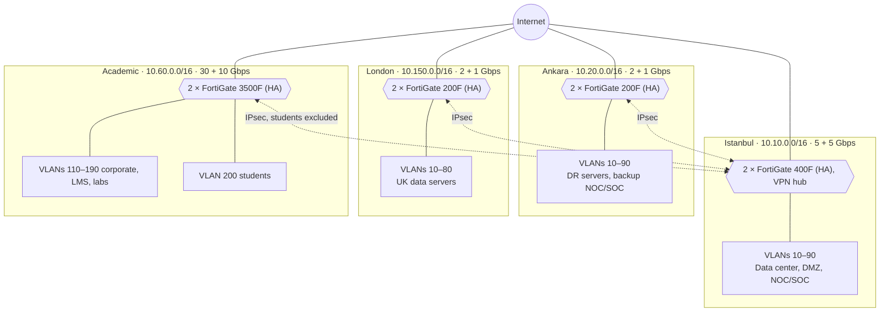
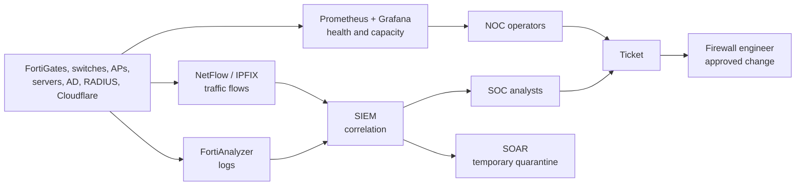

# MT Technology Group — Multi-Branch Firewall Design

> Contributed by `D*** P***` ([@denizpekova](https://github.com/denizpekova)) · BGT207 Güvenlik Duvarı Çözümleri · 2026-2027 Güz midterm project.
> Student names are masked on purpose. Converted from the student's English README and branch notes; the Rust simulation lab of the original repository is not included here.


MT Technology Group is a fictional company with three offices and one academic campus. This document defines the headcount, how each site uses the network, the bandwidth it needs, the VLANs, the firewalls, the main network and cloud risks, and the monitoring model.

Headcounts, IP addresses and bandwidth values are project assumptions.

## Headcount, bandwidth and firewall matrix per branch

| Branch | Admin staff | Faculty | Students | Software | Technical | Security | R&D | **Total** | Required (formula) | Primary + backup link | Selected NGFW (HA) |
|---|---:|---:|---:|---:|---:|---:|---:|---:|---:|---|---|
| [Istanbul Office](#istanbul-office) | 280 | 0 | 0 | 60 | 35 | 25 | 20 | **420** | 3.95 Gbps | 5 + 5 Gbps | **FortiGate 400F** |
| [Ankara Office](#ankara-office) | 140 | 0 | 0 | 30 | 20 | 15 | 15 | **220** | 1.50 Gbps | 2 + 1 Gbps | **FortiGate 200F** |
| [London Office](#london-office) | 135 | 0 | 0 | 30 | 18 | 15 | 12 | **210** | 1.35 Gbps | 2 + 1 Gbps | **FortiGate 200F** |
| [Academic Branch](#academic-branch) | 220 | 400 | **10,000** | 30 | 60 | 0 | 40 | **10,750** | 27.29 Gbps | 30 + 10 Gbps | **FortiGate 3500F** |
| **Total** | **775** | **400** | **10,000** | **150** | **133** | **55** | **87** | **11,600** | **34.09 Gbps** | **39 + 17 Gbps** | |

## 1. Sites and headcount

| Site | Role | Admin staff | Faculty | Students | Software | Technical | Security | R&D | **Total** |
|---|---|---:|---:|---:|---:|---:|---:|---:|---:|
| [Istanbul Office](#istanbul-office) | HQ, data center, public website, VPN hub, NOC/SOC | 280 | 0 | 0 | 60 | 35 | 25 | 20 | **420** |
| [Ankara Office](#ankara-office) | Government projects, backup NOC/SOC | 140 | 0 | 0 | 30 | 20 | 15 | 15 | **220** |
| [London Office](#london-office) | UK/EMEA sales and software, UK-GDPR | 135 | 0 | 0 | 30 | 18 | 15 | 12 | **210** |
| [Academic Branch](#academic-branch) | Campus, LMS, online exams, labs | 220 | 400 | 10,000 | 30 | 60 | 0 | 40 | **10,750** |
| **Total** | | **775** | **400** | **10,000** | **150** | **133** | **55** | **87** | **11,600** |

## 2. How each group uses the network

| Group | Main usage | Active at peak | Devices per person | Mbps per device | **Peak Mbps per person** |
|---|---|---:|---:|---:|---:|
| Admin staff | ERP, Microsoft 365, VoIP, meetings | 60% | 1.3 | 2.0 | **1.56** |
| Software | Git, CI/CD, container images, cloud APIs | 80% | 1.6 | 5.5 | **7.04** |
| Technical | Patching, remote access, backups | 75% | 1.5 | 4.5 | **5.06** |
| Security | SIEM, threat intelligence feeds | 85% | 1.5 | 5.0 | **6.38** |
| R&D | Datasets, model weights, GPU cluster | 80% | 1.7 | 7.5 | **10.20** |
| Faculty | Live lectures, academic databases | 70% | 1.5 | 3.0 | **3.15** |
| Students | LMS videos, web, online exams | 55% | 1.8 | 1.5 | **1.49** |

## 3. Bandwidth

```text
Required = (people × active share × devices × Mbps per device + fixed loads) × 1.10 × 1.35
```

The 1.10 factor covers VLAN and IPsec/TLS overhead. The 1.35 factor covers traffic bursts and 3 years of growth.

| Site | People traffic | Fixed loads | Raw total | **Required** | Primary link | Backup link | Primary link usage |
|---|---:|---|---:|---:|---:|---:|---:|
| Istanbul | 1,399.8 Mbps | Data center and VPN 1,200; guest 60 | 2,659.8 Mbps | **3.95 Gbps** | 5 Gbps | 5 Gbps | 79% |
| Ankara | 779.5 Mbps | DR replication 200; guest 30 | 1,009.5 Mbps | **1.50 Gbps** | 2 Gbps | 1 Gbps | 75% |
| London | 731.0 Mbps | UK servers 150; guest 30 | 911.0 Mbps | **1.35 Gbps** | 2 Gbps | 1 Gbps | 68% |
| Academic | 17,376.2 Mbps | LMS and exams 800; guest 200 | 18,376.2 Mbps | **27.29 Gbps** | 30 Gbps | 10 Gbps | 91% |
| **Total** | | | | **34.09 Gbps** | **39 Gbps** | **17 Gbps** | |

When a site runs on a smaller backup link, QoS protects VoIP, management, DR and exam traffic first. Guest and student traffic slows down first.

## 4. VLANs

Every VLAN has its own subnet, and the firewall is its gateway at `.1`. Traffic between VLANs always passes through firewall rules. Each site has its own address block. Each site's servers VLAN holds an infrastructure server at `.5` for DHCP, DNS and NTP.

### Istanbul, Ankara and London

`S` is the site block: Istanbul `10.10`, Ankara `10.20`, London `10.150`.

| VLAN | Use | Network | Istanbul min / max | Ankara min / max | London min / max |
|---:|---|---|---:|---:|---:|
| 10 | Admin staff | `S.10.0/23` | 400 M / 1.5 G | 200 M / 800 M | 200 M / 800 M |
| 20 | Software | `S.20.0/24` | 500 M / 2 G | 250 M / 1 G | 250 M / 1 G |
| 30 | Technical | `S.30.0/24` | 200 M / 1 G | 100 M / 500 M | 100 M / 400 M |
| 40 | Security | `S.40.0/24` | 200 M / 1 G | 100 M / 500 M | 100 M / 400 M |
| 50 | R&D | `S.50.0/24` | 250 M / 2 G | 150 M / 800 M | 120 M / 600 M |
| 60 | Servers | `S.60.0/24` | 1.2 G / 4 G | 250 M / 1 G | 150 M / 600 M |
| 70 | Guest Wi-Fi, internet only | `S.70.0/24` | — / 100 M | — / 50 M | — / 50 M |
| 80 | Network management | `S.80.0/24` | 50 M / 500 M | 50 M / 300 M | 50 M / 200 M |
| 90 | DMZ | `S.90.0/24` | 200 M / 1 G | 100 M / 500 M | Not used |

In London, VLAN 60 holds the UK HR/CRM server, which must not send personal data outside the UK.

### Academic Branch

The site block is `10.60.0.0/16`. Corporate VLANs sit in the lower half and students in the upper half, `10.60.128.0/17`. That gives 32,766 usable addresses for about 18,000 student devices (55%), so the campus still summarizes as one route.

| VLAN | Use | Network | Min / max | Per user |
|---:|---|---|---:|---:|
| 110 | Faculty (400) | `10.60.10.0/23` | 1.5 G / 5 G | 100 M |
| 120 | Admin staff (220) | `10.60.20.0/24` | 400 M / 1.5 G | 50 M |
| 130 | Software (30) | `10.60.30.0/24` | 250 M / 1 G | — |
| 140 | R&D, HPC (40) | `10.60.40.0/24` | 500 M / 3 G | — |
| 150 | Technical (60) | `10.60.50.0/24` | 300 M / 1 G | — |
| 160 | LMS, exam, student affairs servers | `10.60.60.0/24` | 1 G / 4 G | — |
| 170 | Guest Wi-Fi | `10.60.70.0/23` | — / 500 M | 5 M |
| 180 | Network management | `10.60.80.0/24` | 100 M / 500 M | — |
| 190 | Computer labs, exam hall | `10.60.90.0/24` | 500 M / 2 G | — |
| 200 | Students (10,000, about 18,000 devices) | `10.60.128.0/17` | 8 G / 25 G | 25 M |

### Topology



Sites connect to Istanbul with IKEv2 IPsec tunnels (AES-256-GCM, certificate authentication, PFS). Internet traffic leaves locally. Traffic between branches passes through Istanbul and is closed by default. The student network is never placed in a tunnel: the campus IPsec selectors carry only `10.60.0.0/17`.

### Remote access

The site-to-site tunnels link offices, not people. Remote users connect to a role-based IKEv2 VPN on the Istanbul firewall, with a certificate, MFA and Active Directory groups. The group decides the address pool, and the pool decides what the user can reach. SSH is never open to the internet.

| Role | Address pool | Can reach | Service |
|---|---|---|---|
| Firewall engineers | `10.10.100.0/26` | Network management VLANs at all sites | SSH, HTTPS, SNMPv3 |
| Developers | `10.10.100.64/26` | Git and CI/CD `10.10.60.40/29` | SSH, HTTPS |
| Staff | `10.10.100.128/25` | ERP `10.10.60.10` | HTTPS |

"NOC networks" in the rule tables include the firewall engineers' pool, so their access is allowed on both firewalls of a flow.

### Istanbul website

As headquarters, Istanbul hosts the public corporate website, `www.mttechnology.example` (a fictional name), on the DMZ server `10.10.90.10`. Visitors never reach this server directly:

```text
Visitor → Cloudflare WAF → FortiGate rule 1 (Cloudflare IP ranges only, HTTPS, IPS) → DMZ web server
```

| Control | Setting | What it stops |
|---|---|---|
| Proxied DNS | The public DNS record points to Cloudflare | Hides the origin address from visitors |
| Cloudflare WAF (Pro plan or higher) | Cloudflare Managed Ruleset and OWASP Core Ruleset | SQL injection, XSS and known exploits |
| Rate limiting and DDoS protection | At the Cloudflare edge | Floods reach Cloudflare before the 5 Gbps Istanbul link |
| Firewall rule 1 | Accepts HTTPS only from the Cloudflare IP ranges; other internet sources reach deny-all | Attackers who find the origin address and skip the WAF |
| TLS mode Full (strict), Authenticated Origin Pulls | Valid origin certificate, and the server accepts only Cloudflare's client certificate | Forged origin traffic |
| DMZ isolation | No rule lets the DMZ start connections to internal networks; only CI/CD deploys over SSH (rule 17) | A hacked web server reaching the LAN |

The FortiGate address group follows Cloudflare's published IP list, and the SOC reviews it monthly. If it goes stale, valid visitors are blocked. The web server logs the real visitor address from the `CF-Connecting-IP` header, because the firewall sees only Cloudflare addresses. WAF events reach the SIEM through Cloudflare Logpush.

## 5. Firewalls

### Firewall types

| Type | OSI layer | Protects | How it works | Use in this design |
|---|---|---|---|---|
| Packet filter | 3–4 | Network edge | Checks IP, port and protocol; keeps no connection state | Switch and router ACLs, AWS network ACLs |
| Stateful | 3–4 | Network edge | Tracks connections and allows replies to known sessions | AWS security groups |
| Proxy | 7 | Specific services | Sits between client and server and inspects content | Not used as a main control |
| UTM | 3–7 | Small offices | One box for firewall, antivirus, web filter, VPN and IPS | Not used; every site here needs an NGFW |
| NGFW | 3–7 | Enterprise networks | Adds application and user awareness, IPS, SSL inspection | FortiGate at all four sites |
| WAF | 7 | Websites and APIs | Blocks web attacks such as SQL injection and XSS | Cloudflare WAF in front of the Istanbul website; also the LMS |
| Cloud firewall | 3–7 | Cloud networks | Firewall delivered as a service | AWS VPC traffic |
| Host firewall | 3–7 | One computer or server | Runs on the operating system | All servers and lab computers |

An NGFW and a WAF do different jobs, so we use both. The NGFW decides which user and application may reach which network. The WAF looks inside web requests. A SQL injection in the LMS login form can look like normal HTTPS to an NGFW, but a WAF can recognize and block it.

### Top 10 firewall products

This list covers the market. Positions 1–5 follow the weighted score in [Why FortiGate?](#why-fortigate), and positions 6–10 are for special cases rather than ranked by score.

| # | Product | Type | Best for | Main strength | Fit for MT Technology Group |
|---:|---|---|---|---|---|
| 1 | **Fortinet FortiGate** | NGFW | Small office to large campus | One FortiOS at every size, hardware acceleration | **Primary choice at all four sites** |
| 2 | Cisco Secure Firewall | NGFW | Enterprise and campus | Talos threat intelligence, Cisco integration | Strongest option if the network is Cisco |
| 3 | Palo Alto PA-Series | NGFW | Large enterprise, data center | App-ID, User-ID, Panorama | Option for the Istanbul data center |
| 4 | Sophos Firewall (XGS) | NGFW | Small and medium sites | Simple to operate | Option for Ankara or London |
| 5 | Check Point Quantum | NGFW | Large enterprise | Mature policy management | Larger models needed than the ones compared here |
| 6 | Juniper SRX | NGFW | Service providers, large networks | Routing and VPN capacity | Option for a provider-style campus edge |
| 7 | Barracuda CloudGen | NGFW | Distributed branches | SD-WAN and branch links | Option if more small branches open |
| 8 | OPNsense / pfSense | Open-source firewall | Labs and training | Free, flexible | Campus computer labs and teaching |
| 9 | Cloudflare WAF | WAF and CDN | Websites and APIs | Large global network for DDoS absorption | **In front of the Istanbul website**; also the LMS |
| 10 | AWS Network Firewall and AWS WAF | Cloud firewall and WAF | AWS workloads | Native to AWS, scales with use | The AWS VPC in [section 8](#8-cloud-architecture) |

### Top 5 per site

A candidate must have threat protection capacity (IPS, application control and antivirus enabled) of at least the larger of the required bandwidth and the primary link. Every site uses two devices in active-passive HA.

**Istanbul: at least 5 Gbps**

| # | Model | Capacity | Price per unit | Result | Why |
|---:|---|---:|---:|---|---|
| 1 | **Fortinet FortiGate 400F** | 9 Gbps | $12,696 ⁴ | **Selected** | Enough headroom on a 5 Gbps link; manages and logs all four sites |
| 2 | Cisco Secure Firewall 3110 | 17 Gbps ¹ | $41,524 | Qualifies | Talos threat intelligence; needs the separate FMC manager |
| 3 | Sophos XGS 5500 | 12.4 Gbps | $19,399 | Qualifies | Simple to operate; weaker for central multi-site operations |
| 4 | Palo Alto PA-3410 | 5.9–7.5 Gbps ² | $32,584 | Qualifies | Strong App-ID and Panorama; little headroom at the low figure |
| 5 | Check Point Quantum 6600 | 3.7 Gbps | $39,332 | Eliminated | Below 5 Gbps |

**Ankara and London: at least 2 Gbps**

| # | Model | Capacity | Price per unit | Result | Why |
|---:|---|---:|---:|---|---|
| 1 | **Fortinet FortiGate 200F** ³ | 3 Gbps | $4,087 | **Selected** | Same FortiOS as HQ, so Ankara can take over as the backup site |
| 2 | Cisco Secure Firewall 3105 | About 10 Gbps ¹ ² | $19,836 ⁵ | Qualifies | More capacity than these sites need; adds FMC management |
| 3 | Sophos XGS 4500 | 8.4 Gbps | $12,554 | Qualifies | Simple to operate; separate from the HQ management platform |
| 4 | Palo Alto PA-1410 | 3.3–4.5 Gbps ² | $11,664 | Qualifies | Strong application control; higher expected licence cost |
| 5 | Check Point Quantum 3800 | 1.5 Gbps | $12,199 ⁵ | Eliminated | Below 2 Gbps |

**Academic Branch: at least 30 Gbps**

| # | Model | Capacity | Price per unit | Result | Why |
|---:|---|---:|---:|---|---|
| 1 | **Fortinet FortiGate 3500F** | 63 Gbps | $205,357 ⁴ | **Selected** | About 2× headroom and hardware acceleration for student sessions |
| 2 | Cisco Secure Firewall 4225 | 90 Gbps ¹ | $241,544 | Qualifies | Highest listed figure; natural fit for a Cisco campus |
| 3 | Palo Alto PA-5420 | About 50 Gbps ² | $142,343 | Qualifies | Strong threat prevention and a lower listed hardware price; less headroom than the selected 63 Gbps |
| 4 | Sophos XGS 8500 | 34 Gbps | $70,956 ⁵ | Qualifies | Little headroom above the 30 Gbps link |
| 5 | Check Point Quantum Force 9700 | 16.6 Gbps | $75,851 | Eliminated | Below 30 Gbps |

¹ Cisco publishes IPS or FW + AVC figures, measured differently from the others, so they are not directly comparable.
² Sources disagree or the figure could not be confirmed.
³ One reseller reports that new 200F orders stopped in March 2026, with the 200G as its replacement. Confirm this with Fortinet before ordering.

Most figures come from resellers, so check them against current vendor datasheets before purchase.

⁴ Converted from Canadian dollars at the seller's own rate of about 1.40 CAD per USD.
⁵ The seller blocks automated access, so this price comes from a search listing and was not read from the page itself.

### Prices

Prices are for one unit, from reseller listings read on 2026-11-06. They are not quotes: sellers disagreed by tens of thousands of dollars for the same model. Fortinet, Cisco, Palo Alto and Sophos prices are hardware without multi-year licences. Check Point listings include a 1-year SandBlast subscription, and the Quantum 6600 listing is the Plus configuration.

Every site needs an HA pair, so the total is twice the unit prices for one Istanbul, two Ankara/London and one campus firewall:

| Vendor | Istanbul unit | Ankara and London unit | Campus unit | **Four-site HA hardware total** | Campus price per Gbps |
|---|---:|---:|---:|---:|---:|
| Sophos | $19,399 | $12,554 | $70,956 | **$230,926** | $2,087 |
| Check Point (fails the capacity filter) | $39,332 | $12,199 | $75,851 | **$279,162** | $4,569 |
| Palo Alto | $32,584 | $11,664 | $142,343 | **$396,510** | $2,847 |
| **Fortinet** | $12,696 | $4,087 | $205,357 | **$452,454** | $3,260 |
| Cisco | $41,524 | $19,836 | $241,544 | **$645,480** | $2,684 |

FortiGate has the lowest hardware price in Istanbul and at Ankara and London, but not at the campus, and the campus decides the total.

The Istanbul website adds Cloudflare Pro at $20 a month billed annually ($25 billed monthly). Logpush usage is charged separately and is not included.

### Top 5 per network segment

These segments are separate policies on the site firewall. The options apply if a segment later needs its own product.

| Segment | Estimated bandwidth | Options, best fit first |
|---|---:|---|
| Istanbul servers (east-west) | 10 Gbps | FortiGate 600F, Palo Alto PA-3430, Cisco Secure Firewall 3120, Check Point Quantum 6900, VMware NSX |
| Student network and campus Wi-Fi | 15–22 Gbps | FortiGate 3500F VDOM, Palo Alto PA-5420 virtual system, FortiNAC + FortiGate, Cisco ISE + Secure Firewall, Aruba ClearPass + NGFW |
| R&D networks | 1–3 Gbps | Separate zone with DLP on the site FortiGate, FortiGate 200F, Palo Alto PA-460, Cisco Secure Firewall 1220, Check Point Quantum 3800 |
| Guest networks | 50–500 Mbps | Separate VLAN on the site FortiGate, FortiAP captive portal, Cisco Meraki, Sophos XGS + AP, Ubiquiti UniFi |
| Software team cloud | 1–2 Gbps | FortiGate VM, Palo Alto VM-Series, AWS Network Firewall or Azure Firewall, Cloudflare or AWS WAF, Calico or Cilium |

### Why FortiGate?

FortiGate is not selected for having the highest capacity: Cisco lists a higher figure at the campus. It is selected because one team can run all four sites from one product family, with the lowest listed hardware price at three of the four sites. It is not the cheapest at the campus or in total; see [Prices](#prices).

Scores from 1 to 5 are our own design judgment.

| Criterion | Weight | Fortinet | Cisco | Palo Alto | Sophos | Check Point |
|---|---:|---:|---:|---:|---:|---:|
| Capacity with security services enabled | 25% | 4 | 5 | 4 | 3 | 2 |
| Central management and logging | 25% | 5 | 4 | 5 | 3 | 5 |
| Expected 5-year cost | 25% | 5 | 3 | 2 | 4 | 2 |
| Same product family from branch to campus | 15% | 5 | 4 | 4 | 3 | 3 |
| Vulnerability record and vendor risk | 10% | 2 | 3 | 3 | 3 | 3 |
| **Weighted score** | | **4.45** | **3.90** | **3.65** | **3.25** | **3.00** |

| Vendor | Strength | Why it is not the primary choice here |
|---|---|---|
| **Fortinet** | FortiManager and FortiAnalyzer, one FortiOS at every size, hardware acceleration | **Weakness:** repeated critical FortiOS vulnerabilities and single-vendor risk |
| Cisco | High listed capacity, Talos threat intelligence | Needs the FMC manager; the fit is best in an existing Cisco network |
| Palo Alto | App-ID and User-ID, Panorama, lower campus hardware price | Lower capacity at the low figures in Istanbul and Ankara/London; subscription cost not yet compared |
| Sophos | Simple to operate | Little headroom at the campus; weaker for four-site central operations |
| Check Point | Mature policy management | Failed the capacity threshold at all three site sizes with the models compared |

**Limits of this decision:**

- The cost scores are estimates of 5-year cost because we have no vendor quotes or comparable subscription prices. Without the cost row, Fortinet leads Cisco and Palo Alto only narrowly (4.27 vs 4.20 each).
- **Listed hardware prices do not support the Fortinet cost score on their own.** If the cost row followed the four-site hardware totals (Sophos 5, Palo Alto and Check Point 4, Fortinet 3, Cisco 2), Palo Alto would lead with 4.15, ahead of Fortinet's 3.95. The choice of FortiGate therefore depends on 5-year licence cost and on one product family, and real quotes could change it.
- To reduce the vulnerability risk, we use the patch routine in [section 10](#10-monitoring), keep management interfaces off the internet, use IPsec instead of SSL VPN, and require MFA.

## 6. Firewall rules

Rules run top to bottom and the first match wins. Every site starts with the same opening rules below, and ends with **deny all and log**. A flow between two sites must be allowed on both firewalls.

**Opening rules at every site** (`S` is the site block; the campus uses `10.60`)

| # | Source | Destination | Service | Action |
|---|---|---|---|---|
| A | Internet with a private source address | Site networks | Any | Deny |
| B | Other site firewalls | IPsec gateway on this firewall | UDP 500, 4500 | Allow |
| C | All site VLANs | Infrastructure server `S.60.5` | DHCP, UDP 67–68 | Allow |
| D | All site VLANs | Infrastructure server `S.60.5` | DNS 53 | Allow |
| E | All site VLANs except guest | Infrastructure server `S.60.5` | NTP, UDP 123 | Allow |
| F | Infrastructure server `S.60.5` | Internet | DNS 53, NTP 123 | Allow |

Without rule C, deny-all would leave clients with no IP address. Guests reach the infrastructure server for DHCP and DNS only, because rules C and D sit above the guest deny rule.

**Istanbul**

| # | Source | Destination | Service | Action |
|---:|---|---|---|---|
| 1 | Cloudflare IP ranges | DMZ website `10.10.90.10` | HTTPS | Allow, with IPS (Cloudflare WAF first) |
| 2 | NOC networks (Istanbul, Ankara) | Network management VLAN | SSH, HTTPS, SNMPv3 | Allow |
| 3 | All sites | FortiAnalyzer and SIEM | Syslog 514, 6514 | Allow |
| 4 | Security VLANs (Istanbul, Ankara) | FortiAnalyzer and SIEM | HTTPS, 9200 | Allow |
| 5 | Software VLANs (all sites) | Git and CI/CD `10.10.60.40/29` | SSH, HTTPS | Allow |
| 6 | R&D VLANs (Istanbul, Ankara, campus) | GPU cluster `10.10.60.64/27` | SSH, HTTPS, 8888 | Allow |
| 7 | Admin VLANs (all sites) | ERP `10.10.60.10` | HTTPS | Allow |
| 8 | Guest VLAN | Internal networks | Any | Deny |
| 9 | Guest VLAN | Internet | DNS, HTTP, HTTPS | Allow, rate limited |
| 10 | Corporate VLANs | Internet | DNS, HTTP, HTTPS | Allow, with filtering |
| 11 | Servers VLAN | Ankara DR servers | HTTPS, 514, rsync | Allow |
| 12 | Istanbul NOC | Network management VLANs at the other sites | SSH, HTTPS, SNMPv3 | Allow |
| 13 | Internet | Remote-access gateway on this firewall | UDP 500, 4500 | Allow, rate limited |
| 14 | VPN admin pool `10.10.100.0/26` | Network management VLANs (all sites) | SSH, HTTPS, SNMPv3 | Allow |
| 15 | VPN developer pool `10.10.100.64/26` | Git and CI/CD `10.10.60.40/29` | SSH, HTTPS | Allow |
| 16 | VPN staff pool `10.10.100.128/25` | ERP `10.10.60.10` | HTTPS | Allow |
| 17 | CI/CD `10.10.60.40/29` | DMZ website `10.10.90.10` | SSH | Allow |

**Ankara**

| # | Source | Destination | Service | Action |
|---:|---|---|---|---|
| 1 | NOC networks | Network management VLAN | SSH, HTTPS, SNMPv3 | Allow |
| 2 | Istanbul servers (VPN) | DR servers | HTTPS, 514, rsync | Allow |
| 3 | Software VLAN | Government DMZ | HTTPS, 8443 | Allow |
| 4 | R&D VLAN | Dropbox, WeTransfer, MEGA | Any | Deny |
| 5 | Guest VLAN | Internal networks | Any | Deny |
| 6 | Guest VLAN | Internet | DNS, HTTP, HTTPS | Allow, rate limited |
| 7 | Corporate VLANs | Internet | DNS, HTTP, HTTPS | Allow, with filtering |
| 8 | Corporate VLANs | Istanbul servers (VPN) | SSH, HTTPS | Allow |
| 9 | Ankara backup NOC | Network management VLANs at the other sites | SSH, HTTPS, SNMPv3 | Allow |

**London**

| # | Source | Destination | Service | Action |
|---:|---|---|---|---|
| 1 | NOC networks | Network management VLAN | SSH, HTTPS, SNMPv3 | Allow |
| 2 | HR/CRM server `10.150.60.15` | Other sites and internet | Any | Deny, critical alert (UK-GDPR) |
| 3 | Admin VLAN | HR/CRM server | HTTPS | Allow |
| 4 | Software VLAN | Internet (cloud APIs) | SSH, HTTPS | Allow |
| 5 | Guest VLAN | Internal networks | Any | Deny |
| 6 | Guest VLAN | Internet | DNS, HTTP, HTTPS | Allow, rate limited |
| 7 | Corporate VLANs | Internet | DNS, HTTP, HTTPS | Allow, with filtering |
| 8 | Corporate VLANs | Istanbul servers (VPN) | SSH, HTTPS | Allow |

**Academic Branch**

| # | Source | Destination | Service | Action |
|---:|---|---|---|---|
| 1 | NOC networks (campus, Istanbul, Ankara) | Network management VLAN | SSH, HTTPS, SNMPv3 | Allow |
| 2 | Students, labs | LMS and exam servers | HTTPS | Allow, top priority |
| 3 | Students, labs | Internet | Any | Deny, only during exam hours |
| 4 | Students | Corporate networks and other sites | Any | Deny and alert |
| 5 | Students | Any | P2P applications | Deny |
| 6 | Students, labs | Internet | DNS, HTTP, HTTPS | Allow, 25 Mbps per user |
| 7 | Faculty | LMS and exam administration | HTTPS, 8443 | Allow |
| 8 | Admin staff | Student affairs system | HTTPS | Allow |
| 9 | Corporate VLANs | Istanbul servers (VPN) | SSH, HTTPS | Allow |
| 10 | Guest VLAN | Internal networks | Any | Deny |
| 11 | Corporate and guest VLANs | Internet | DNS, HTTP, HTTPS | Allow, with filtering |

## 7. Network vulnerabilities and countermeasures

| Vulnerability or attack | Layer | Risk | Countermeasure in this design |
|---|---:|---|---|
| ARP spoofing, man in the middle | 2 | Attacker poses as the gateway and reads traffic | Dynamic ARP Inspection and DHCP Snooping on switches |
| VLAN hopping | 2 | Attacker jumps to another VLAN | Unused ports disabled, native VLAN changed, trunks only where needed |
| Rogue DHCP server | 2 | Users are sent to a fake gateway | DHCP Snooping |
| Fake Wi-Fi access point | 2 | Users join a look-alike network | WPA3-Enterprise and 802.1X, wireless intrusion detection |
| Open or unnecessary ports | 4 | Internet scans find exposed services | Default deny, regular external scans |
| DDoS | 3–7 | Links or servers are overwhelmed | ISP DDoS protection, Cloudflare in front of web services, firewall rate limits |
| Skipping the WAF by attacking the origin directly | 7 | Web attacks reach the server with no WAF inspection | Firewall rule 1 accepts only Cloudflare IP ranges, Authenticated Origin Pulls |
| Unpatched firmware | All | Known vulnerabilities are exploited | Monthly patch window, vulnerability scanner |
| Weak or stolen credentials | 7 | Attacker gets VPN or admin access | MFA, account lockout, certificate-based IPsec |
| Lateral movement | 3–7 | One infected device spreads to others | VLANs, closed branch-to-branch traffic, SOAR quarantine |
| Phishing and ransomware | 7 | A user opens a malicious file or link | Mail security gateway, web filter, endpoint protection, staff training, offline backups |
| Data exfiltration | 7 | Sensitive data leaves the company | DLP and application control, UK-GDPR block in London, NetFlow analysis |
| Web attacks (SQL injection, XSS) | 7 | Data leaks through the portal or LMS | WAF, DMZ, regular application testing |

A penetration test runs at least once a year. The Academic Branch comes first because it has the most users and the least control over their devices.

## 8. Cloud architecture

The company uses a hybrid model with AWS as the example provider:

- **On premises:** the public website origin, ERP, student records and other sensitive data stay in the Istanbul and campus data centers. UK personal data stays on the London servers.
- **In the cloud:** extra LMS web capacity during exam periods, test environments for software teams, and encrypted backups of non-UK data.

| Component | Purpose | Use in this design |
|---|---|---|
| VPC | Isolated company network in the cloud | `10.200.0.0/16`, which does not overlap with any site |
| Public and private subnets | Separate internet-facing and internal systems | Load balancer in public; web and test servers in private |
| Security group | Stateful firewall per server | Web servers accept HTTPS only from the load balancer |
| Network ACL | Stateless filter per subnet | No direct internet access into private subnets |
| AWS Network Firewall | Inspects and filters VPC traffic | Servers reach only approved destinations |
| Cloudflare WAF and AWS WAF | Stops web attacks, bots and DDoS | Cloudflare in front of the Istanbul website; AWS WAF in front of the extra LMS capacity |
| Site-to-site VPN | Encrypted link to the company | Two IPsec tunnels between Istanbul and AWS |
| IAM and MFA | Controls who can do what | Role-based access, MFA for everyone, root account locked |
| S3 | Backup storage | Encrypted, with public access blocked |
| CloudTrail and GuardDuty | Records actions and finds threats | Logs forwarded to the SIEM in Istanbul |

**Shared responsibility:** AWS secures the data centers, hardware and virtualization. We secure our configuration, data, users and access rules.

| Common cloud mistake | How we prevent it |
|---|---|
| Public storage bucket | Block Public Access at account level |
| Accounts with too many permissions | Least privilege; remove unused keys after 90 days |
| Access keys stored in code | Secrets manager, never in Git |
| SSH or RDP open to the internet | Management only over the VPN |

## 9. Installation order

Install Istanbul first, then Ankara and London. Install the Academic Branch last, between terms.

1. Rack two firewalls, each with dual power, and connect both ISP links.
2. Update the firmware to the current fixed release. Disable unencrypted management and FortiCloud SSO admin login, and require MFA and personal admin accounts.
3. Build the active-passive HA pair and test failover.
4. Create the VLAN interfaces and security zones.
5. Configure SD-WAN health checks and QoS.
6. Build the IPsec tunnels to Istanbul. In Istanbul, also build the role-based remote access VPN.
7. Connect identity: Active Directory at the offices, eduroam 802.1X RADIUS at the campus.
8. Apply the rules with an explicit deny-and-log rule last, and send logs to FortiAnalyzer.
9. Test VLAN isolation, HA, link failover, VPN recovery, QoS and logging, then go live.
10. In Istanbul, publish the website: proxy its DNS through Cloudflare, turn on the managed rulesets, Full (strict) and Authenticated Origin Pulls, then confirm that a direct request to the origin is blocked.

## 10. Monitoring

Professional monitoring has two centers: the NOC checks that the network is up, and the SOC looks for attacks.



### Systematic side

| Tool | Monitors | Example alert |
|---|---|---|
| FortiManager | Rules, firmware, device configuration | Unapproved or out-of-hours rule change |
| FortiAnalyzer | Firewall, VPN, IPS and web logs | Critical IPS event |
| SIEM (Splunk or Wazuh) | Firewall logs combined with AD, RADIUS and server logs | One source denied on 10 different ports (port scan) |
| Prometheus and Grafana, via SNMPv3 | CPU, RAM, sessions, links, HA | WAN above 80% for 15 minutes; primary link down for 1 minute |
| NetFlow/IPFIX | Who talks to whom, and how much | Unusual large upload at night |
| Vulnerability scanner (Nessus or OpenVAS) | Unpatched devices and exposed services | Critical CVE on a firewall |
| Cloudflare Logpush | WAF events and requests for the Istanbul website | Sudden rise in blocked requests |
| SOAR | Automatic response | Quarantine a scanning IP for 60 minutes |

| Event | Threshold | Priority | Team |
|---|---|---|---|
| VPN tunnel down | 2 minutes; escalate at 5 minutes | High | NOC |
| Primary link down | 1 minute | High | NOC |
| Both links down at a site | 1 minute | Critical | NOC on call |
| WAN usage | Above 80% for 15 minutes | Medium | NOC |
| Firewall CPU or RAM | Above 80% for 15 minutes | Medium | NOC |
| Failed admin logins | 5 attempts | Critical | SOC |
| Port scan | 10 different ports from one source | Critical | SOAR, then SOC |
| Student network reaching for corporate networks | 1 event per source | High | SOC |
| Website origin reached from outside Cloudflare | 1 event per source | High | SOC |
| UK personal data transfer attempt | 1 event | Critical | Incident manager, DPO |

Logs stay online for 90 days and in the archive for 2 years. Law 5651 logs are signed daily with a timestamp. London logs are kept separately and use pseudonyms instead of user names.

### Human side

| Role | People | Responsibility | Limit |
|---|---:|---|---|
| NOC operator | 5 | Links, VPN, HA, capacity | Cannot change permanent rules |
| SOC analyst, Tier 1 | 5 | First review, false positives, severity | Cannot change policy |
| SOC analyst, Tier 2 | 3 | Investigation, reviews SOAR actions | Proposes isolation |
| Firewall engineer | 3 | Rules, VLANs, VPN, HA | Needs a ticket and a second approver |
| Incident manager | 2 | Decisions during critical incidents | Approves emergency isolation |
| Branch IT contact | 4 | Cabling, switches, physical checks | Cannot change central policy |
| Information security manager, DPO | 2 | Audits, KVKK and UK-GDPR | Decides on legal notification |

One seat staffed 24/7 needs about 5 people: 168 hours a week ÷ 40 hours = 4.2, plus cover for leave. The NOC and SOC each keep one seat open in three shifts from Istanbul, with Ankara as backup. Shift handovers are written, and a firewall engineer is on call.

| Severity | Example | First response |
|---|---|---|
| Critical | Port scan, UK data transfer attempt, isolated site | 15 minutes |
| High | Primary link down, student reaching for a corporate network | 30 minutes |
| Medium | WAN above 80%, HA failover | 2 hours |
| Low | Capacity trend, unused rule | 1 working day |

**Incident flow:** alert → ticket → validate → classify → temporary isolation if needed → escalate → approved change → recover → record the root cause → review within 5 working days for critical incidents.

**Automation limit:** automation can raise alerts, fail over to the backup link and quarantine a single IP temporarily. Permanent rule changes, shutting down a VLAN, creating admin accounts and deleting logs always need human approval.

**Change control:** every rule change has a ticket, a reason, a rollback plan and a second approver. Critical rules are reviewed monthly, the rest quarterly, and a rule with no hits for 90 days becomes a removal candidate.

**Measured targets:** time to detect under 10 minutes, time to respond to critical incidents under 60 minutes, false positives under 20%, no rule change without a ticket, and no unmonitored device.

**Patch routine:** firewall engineers patch FortiOS, FortiManager and FortiAnalyzer in a monthly window, one HA member at a time, and test in Ankara before Istanbul and the campus. A vulnerability under active exploitation is patched within 72 hours. The SOC follows Fortinet PSIRT advisories and the CISA KEV catalog.

**CVE watch:** we track [CVE-2026-24858](https://www.fortiguard.com/psirt/FG-IR-26-060), a FortiCloud SSO authentication bypass that was exploited in the wild and affects FortiOS, FortiManager and FortiAnalyzer. An attacker with a FortiCloud account could log in to devices registered to other accounts.

- **Temporary mitigation:** keep "Allow administrative login using FortiCloud SSO" off, and keep management interfaces off the internet.
- **Permanent fix:** run at or above the fixed versions, FortiOS 7.4.11 or 7.6.6 and FortiManager and FortiAnalyzer 7.4.10 or 7.6.6.
- **Check:** look for the advisory's indicators of compromise, such as unexpected local admin accounts.

**Drills:** HA failover and link outage tests every quarter, and a cyber incident tabletop exercise and penetration test every year.

## 11. Summary

The four sites need 34.09 Gbps at peak and have 39 Gbps of primary links. Staff, students, servers and guests are separated by VLANs, and every flow between them passes through a firewall rule. FortiGate HA pairs protect every site and are managed centrally from Istanbul, with Ankara as backup. Cloudflare WAF protects the Istanbul website, and cloud firewalls protect the AWS network. The NOC and SOC monitor all sites 24/7, automation handles only temporary actions, and permanent changes need human approval.

## Sources

- Vulnerability: [Fortinet FG-IR-26-060](https://www.fortiguard.com/psirt/FG-IR-26-060), [CISA alert on CVE-2026-24858](https://www.cisa.gov/news-events/alerts/2026/01/28/fortinet-releases-guidance-address-ongoing-exploitation-authentication-bypass-vulnerability-cve-2026)
- FortiGate capacity: [200F](https://datacenter360.ca/fortinet/fortigate/fortigate-200f-firewall/), [400F](https://datacenter360.ca/fortinet/fortigate/fortigate-400f-firewall/), [3500F](https://datacenter360.ca/fortinet/fortigate/fortigate-3500f-firewall/)
- Palo Alto capacity: [PA-Series comparison](https://paloguard.com/compare-spec.asp)
- Cisco capacity: [3100 Series](https://www.cisco.com/c/en/us/products/collateral/security/firewalls/secure-firewall-3100-series-ds.html), [4200 Series](https://www.cisco.com/site/cn/zh/products/security/firewalls/secure-firewall-4200-series/index.html)
- Check Point capacity: [3800](https://m.cdw.com/product/check-point-quantum-3800-security-appliance-with-1-year-sandblast-snbt/6107913), [6600](https://www.checkpoint.com/next-generation-firewall/midsize-enterprise-security/quantum-6600), [Quantum Force 9700](https://www.checkpoint.com/downloads/products/quantum-force-9700-datasheet.pdf)
- Sophos capacity: [XGS 4500 and 5500](https://www.firewalls.com/brands/sophos/firewalls/xgs-firewalls.html), [XGS 8500](https://usmb.channelonline.com/acme/classic/Products/overview/M024229429)
- Cloudflare: [plans](https://www.cloudflare.com/plans/), [managed rulesets](https://developers.cloudflare.com/waf/managed-rules/), [Full (strict)](https://developers.cloudflare.com/ssl/origin-configuration/ssl-modes/full-strict/), [IP addresses](https://developers.cloudflare.com/fundamentals/concepts/cloudflare-ip-addresses/), [Logpush](https://developers.cloudflare.com/logs/logpush/)
- Fortinet prices: [200F](https://datacenter360.ca/shop/network-security/firewall/appliances/fortigate-200f-appliance-only-fg-200f/), [400F](https://datacenter360.ca/shop/network-security/firewall/appliances/fortigate-400f-appliance-only-fg-400f/), [3500F](https://datacenter360.ca/shop/network-security/firewall/appliances/fortigate-3500f-appliance-only-fg-3500f/)
- Cisco prices: [3110](https://www.zones.com/site/product/index.html?id=110546148), [3105](https://www.cdw.com/product/cisco-firepower-3105-next-generation-firewall-security-appliance/7990190), [4225](https://www.zones.com/site/product/index.html?id=113605363)
- Palo Alto prices: [PA-3410](https://www.zones.com/site/product/index.html?id=110445631), [PA-1410](https://www.zones.com/site/product/index.html?id=110975712), [PA-5420](https://networkdevicesinc.com/products/pan-pa-5420-ac)
- Sophos prices: [XGS 5500](https://www.corporatearmor.com/product/sophos-xgs-5500-network-security-firewall-appliance8-port10-100-1000base-t-10gbase-x10-gigabit-ethernet8-x-rj-4511-total-expan-xg5etchus/), [XGS 4500](https://www.corporatearmor.com/product/sophos-xgs-4500-network-security-firewall-appliance8-port10-100-1000base-t-2-5gbase-t-10gbase-x10-gigabit-ethernet8-x-rj-456-xg4etchus/), [XGS 8500](https://www.cdw.com/product/sophos-xgs-8500-security-appliance/7699408)
- Check Point prices: [6600](https://tecisoft.com/products/check-point-quantum-6600-security-gateway), [3800](https://www.cdw.com/product/checkpoint-3800-base-appliance/6107913), [Quantum Force 9700](https://www.checkfirewalls.com/quantum-9700.asp)


# Branch notes

# Istanbul Office

Headquarters, data center, public website behind Cloudflare WAF, VPN hub and NOC/SOC. Details and the reasoning are in the sections above.

## People and bandwidth

| Group | People | Peak traffic |
|---|---:|---:|
| Admin staff | 280 | 436.8 Mbps |
| Software | 60 | 422.4 Mbps |
| Technical | 35 | 177.2 Mbps |
| Security | 25 | 159.4 Mbps |
| R&D | 20 | 204.0 Mbps |
| Data center and VPN | — | 1,200.0 Mbps |
| Guest Wi-Fi | — | 60.0 Mbps |
| **Total** | **420** | **2,659.8 Mbps** |

**Required:** 3.95 Gbps. **Links:** 5 Gbps primary and 5 Gbps backup.

## VLANs

Site block: `10.10.0.0/16`

| VLAN | Use | Network | Min / max |
|---:|---|---|---:|
| 10 | Admin staff | `10.10.10.0/23` | 400 M / 1.5 G |
| 20 | Software | `10.10.20.0/24` | 500 M / 2 G |
| 30 | Technical | `10.10.30.0/24` | 200 M / 1 G |
| 40 | Security | `10.10.40.0/24` | 200 M / 1 G |
| 50 | R&D | `10.10.50.0/24` | 250 M / 2 G |
| 60 | Servers | `10.10.60.0/24` | 1.2 G / 4 G |
| 70 | Guest Wi-Fi | `10.10.70.0/24` | — / 100 M |
| 80 | Network management | `10.10.80.0/24` | 50 M / 500 M |
| 90 | DMZ, website `10.10.90.10` | `10.10.90.0/24` | 200 M / 1 G |

## Firewall

**Selected:** 2 × Fortinet FortiGate 400F in active-passive HA (9 Gbps threat protection, target at least 5 Gbps).

## Rules

The list starts with opening rules A–F from section 6 and ends with deny all and log.

| # | Source | Destination | Service | Action |
|---:|---|---|---|---|
| 1 | Cloudflare IP ranges | DMZ website `10.10.90.10` | HTTPS | Allow, with IPS (Cloudflare WAF first) |
| 2 | NOC networks (Istanbul, Ankara) | Network management VLAN | SSH, HTTPS, SNMPv3 | Allow |
| 3 | All sites | FortiAnalyzer and SIEM | Syslog 514, 6514 | Allow |
| 4 | Security VLANs (Istanbul, Ankara) | FortiAnalyzer and SIEM | HTTPS, 9200 | Allow |
| 5 | Software VLANs (all sites) | Git and CI/CD `10.10.60.40/29` | SSH, HTTPS | Allow |
| 6 | R&D VLANs (Istanbul, Ankara, campus) | GPU cluster `10.10.60.64/27` | SSH, HTTPS, 8888 | Allow |
| 7 | Admin VLANs (all sites) | ERP `10.10.60.10` | HTTPS | Allow |
| 8 | Guest VLAN | Internal networks | Any | Deny |
| 9 | Guest VLAN | Internet | DNS, HTTP, HTTPS | Allow, rate limited |
| 10 | Corporate VLANs | Internet | DNS, HTTP, HTTPS | Allow, with filtering |
| 11 | Servers VLAN | Ankara DR servers | HTTPS, 514, rsync | Allow |
| 12 | Istanbul NOC | Network management VLANs at the other sites | SSH, HTTPS, SNMPv3 | Allow |
| 13 | Internet | Remote-access gateway on this firewall | UDP 500, 4500 | Allow, rate limited |
| 14 | VPN admin pool `10.10.100.0/26` | Network management VLANs (all sites) | SSH, HTTPS, SNMPv3 | Allow |
| 15 | VPN developer pool `10.10.100.64/26` | Git and CI/CD `10.10.60.40/29` | SSH, HTTPS | Allow |
| 16 | VPN staff pool `10.10.100.128/25` | ERP `10.10.60.10` | HTTPS | Allow |
| 17 | CI/CD `10.10.60.40/29` | DMZ website `10.10.90.10` | SSH | Allow |


# Ankara Office

Government projects and the backup NOC/SOC site. Details and the reasoning are in the sections above.

## People and bandwidth

| Group | People | Peak traffic |
|---|---:|---:|
| Admin staff | 140 | 218.4 Mbps |
| Software | 30 | 211.2 Mbps |
| Technical | 20 | 101.3 Mbps |
| Security | 15 | 95.6 Mbps |
| R&D | 15 | 153.0 Mbps |
| DR replication | — | 200.0 Mbps |
| Guest Wi-Fi | — | 30.0 Mbps |
| **Total** | **220** | **1,009.5 Mbps** |

**Required:** 1.50 Gbps. **Links:** 2 Gbps primary and 1 Gbps backup.

## VLANs

Site block: `10.20.0.0/16`

| VLAN | Use | Network | Min / max |
|---:|---|---|---:|
| 10 | Admin staff | `10.20.10.0/23` | 200 M / 800 M |
| 20 | Software | `10.20.20.0/24` | 250 M / 1 G |
| 30 | Technical | `10.20.30.0/24` | 100 M / 500 M |
| 40 | Security | `10.20.40.0/24` | 100 M / 500 M |
| 50 | R&D | `10.20.50.0/24` | 150 M / 800 M |
| 60 | DR servers | `10.20.60.0/24` | 250 M / 1 G |
| 70 | Guest Wi-Fi | `10.20.70.0/24` | — / 50 M |
| 80 | Network management | `10.20.80.0/24` | 50 M / 300 M |
| 90 | Government DMZ | `10.20.90.0/24` | 100 M / 500 M |

## Firewall

**Selected:** 2 × Fortinet FortiGate 200F in active-passive HA (3 Gbps threat protection, target at least 2 Gbps). Confirm availability before ordering; section 5 explains why.

## Rules

The list starts with opening rules A–F from section 6 and ends with deny all and log.

| # | Source | Destination | Service | Action |
|---:|---|---|---|---|
| 1 | NOC networks | Network management VLAN | SSH, HTTPS, SNMPv3 | Allow |
| 2 | Istanbul servers (VPN) | DR servers | HTTPS, 514, rsync | Allow |
| 3 | Software VLAN | Government DMZ | HTTPS, 8443 | Allow |
| 4 | R&D VLAN | Dropbox, WeTransfer, MEGA | Any | Deny |
| 5 | Guest VLAN | Internal networks | Any | Deny |
| 6 | Guest VLAN | Internet | DNS, HTTP, HTTPS | Allow, rate limited |
| 7 | Corporate VLANs | Internet | DNS, HTTP, HTTPS | Allow, with filtering |
| 8 | Corporate VLANs | Istanbul servers (VPN) | SSH, HTTPS | Allow |
| 9 | Ankara backup NOC | Network management VLANs at the other sites | SSH, HTTPS, SNMPv3 | Allow |


# London Office

UK/EMEA sales and software, subject to UK-GDPR. Details and the reasoning are in the sections above.

## People and bandwidth

| Group | People | Peak traffic |
|---|---:|---:|
| Admin staff and sales | 135 | 210.6 Mbps |
| Software | 30 | 211.2 Mbps |
| Technical | 18 | 91.1 Mbps |
| Security | 15 | 95.6 Mbps |
| R&D | 12 | 122.4 Mbps |
| UK servers | — | 150.0 Mbps |
| Guest Wi-Fi | — | 30.0 Mbps |
| **Total** | **210** | **911.0 Mbps** |

**Required:** 1.35 Gbps. **Links:** 2 Gbps primary and 1 Gbps backup.

## VLANs

Site block: `10.150.0.0/16`

| VLAN | Use | Network | Min / max |
|---:|---|---|---:|
| 10 | Admin staff and sales | `10.150.10.0/23` | 200 M / 800 M |
| 20 | Software | `10.150.20.0/24` | 250 M / 1 G |
| 30 | Technical | `10.150.30.0/24` | 100 M / 400 M |
| 40 | Security | `10.150.40.0/24` | 100 M / 400 M |
| 50 | R&D | `10.150.50.0/24` | 120 M / 600 M |
| 60 | UK data servers (HR/CRM `.15`) | `10.150.60.0/24` | 150 M / 600 M |
| 70 | Guest Wi-Fi | `10.150.70.0/24` | — / 50 M |
| 80 | Network management | `10.150.80.0/24` | 50 M / 200 M |

## Firewall

**Selected:** 2 × Fortinet FortiGate 200F in active-passive HA (3 Gbps threat protection, target at least 2 Gbps). Confirm availability before ordering; section 5 explains why.

## Rules

The list starts with opening rules A–F from section 6 and ends with deny all and log.

| # | Source | Destination | Service | Action |
|---:|---|---|---|---|
| 1 | NOC networks | Network management VLAN | SSH, HTTPS, SNMPv3 | Allow |
| 2 | HR/CRM server `10.150.60.15` | Other sites and internet | Any | Deny, critical alert (UK-GDPR) |
| 3 | Admin VLAN | HR/CRM server | HTTPS | Allow |
| 4 | Software VLAN | Internet (cloud APIs) | SSH, HTTPS | Allow |
| 5 | Guest VLAN | Internal networks | Any | Deny |
| 6 | Guest VLAN | Internet | DNS, HTTP, HTTPS | Allow, rate limited |
| 7 | Corporate VLANs | Internet | DNS, HTTP, HTTPS | Allow, with filtering |
| 8 | Corporate VLANs | Istanbul servers (VPN) | SSH, HTTPS | Allow |


# Academic Branch

Campus with 10,000 students, LMS, online exams and labs. Details and the reasoning are in the sections above.

## People and bandwidth

| Group | People | Peak traffic |
|---|---:|---:|
| Students | 10,000 | 14,850.0 Mbps |
| Faculty | 400 | 1,260.0 Mbps |
| Admin staff | 220 | 343.2 Mbps |
| Software | 30 | 211.2 Mbps |
| R&D | 40 | 408.0 Mbps |
| Technical | 60 | 303.8 Mbps |
| LMS and exam servers | — | 800.0 Mbps |
| Guest Wi-Fi | — | 200.0 Mbps |
| **Total** | **10,750** | **18,376.2 Mbps** |

**Required:** 27.29 Gbps. **Links:** 30 Gbps primary and 10 Gbps backup.

## VLANs

Site block: `10.60.0.0/16`. Student block: `10.60.128.0/17`, the upper half.

| VLAN | Use | Network | Min / max | Per user |
|---:|---|---|---:|---:|
| 110 | Faculty | `10.60.10.0/23` | 1.5 G / 5 G | 100 M |
| 120 | Admin staff | `10.60.20.0/24` | 400 M / 1.5 G | 50 M |
| 130 | Software | `10.60.30.0/24` | 250 M / 1 G | — |
| 140 | R&D, HPC | `10.60.40.0/24` | 500 M / 3 G | — |
| 150 | Technical | `10.60.50.0/24` | 300 M / 1 G | — |
| 160 | LMS, exam, student affairs servers | `10.60.60.0/24` | 1 G / 4 G | — |
| 170 | Guest Wi-Fi | `10.60.70.0/23` | — / 500 M | 5 M |
| 180 | Network management | `10.60.80.0/24` | 100 M / 500 M | — |
| 190 | Computer labs, exam hall | `10.60.90.0/24` | 500 M / 2 G | — |
| 200 | Students | `10.60.128.0/17` | 8 G / 25 G | 25 M |

## Firewall

**Selected:** 2 × Fortinet FortiGate 3500F in active-passive HA (63 Gbps threat protection, target at least 30 Gbps).

## Rules

The list starts with opening rules A–F from section 6 and ends with deny all and log.

| # | Source | Destination | Service | Action |
|---:|---|---|---|---|
| 1 | NOC networks (campus, Istanbul, Ankara) | Network management VLAN | SSH, HTTPS, SNMPv3 | Allow |
| 2 | Students, labs | LMS and exam servers | HTTPS | Allow, top priority |
| 3 | Students, labs | Internet | Any | Deny, only during exam hours |
| 4 | Students | Corporate networks and other sites | Any | Deny and alert |
| 5 | Students | Any | P2P applications | Deny |
| 6 | Students, labs | Internet | DNS, HTTP, HTTPS | Allow, 25 Mbps per user |
| 7 | Faculty | LMS and exam administration | HTTPS, 8443 | Allow |
| 8 | Admin staff | Student affairs system | HTTPS | Allow |
| 9 | Corporate VLANs | Istanbul servers (VPN) | SSH, HTTPS | Allow |
| 10 | Guest VLAN | Internal networks | Any | Deny |
| 11 | Corporate and guest VLANs | Internet | DNS, HTTP, HTTPS | Allow, with filtering |

